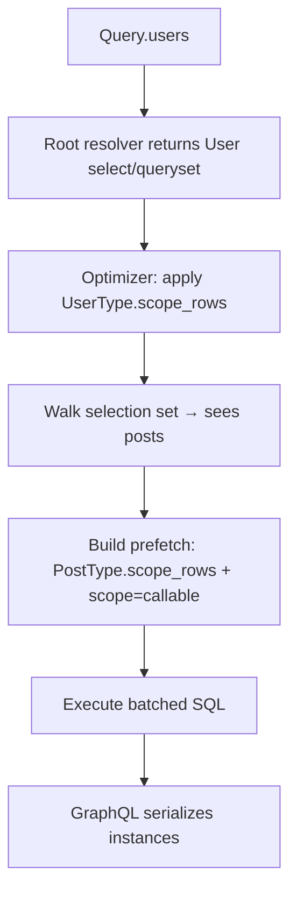

# strawberry-orm

[Tests](https://github.com/strawberry-graphql/strawberry-orm/actions/workflows/tests.yml)
[codecov](https://codecov.io/gh/strawberry-graphql/strawberry-orm)

Backend-agnostic schema generation for [Strawberry GraphQL](https://strawberry.rocks/) on top of Django ORM, SQLAlchemy, and Tortoise ORM.

> **Warning** — `strawberry-orm` is still in **alpha**. Expect breaking changes and incomplete APIs while the package stabilizes.

## Contents

**Start here:** [Installation](#installation) · [Quick start](#quick-start) · [Choose a backend](#choose-a-backend) · [How loading works](#how-loading-works)

**Before you ship:** [Security](#security) · [Production baseline](#production-baseline)

**Feature guide:** [Defining types](#defining-types) · [Declaring fields](#declaring-fields) · [Filters and ordering](#filters-and-ordering) · [Custom filters and ordering](#custom-filters-and-ordering) · [Grouping and aggregation](#grouping-and-aggregation) · [Payloads](#data--errors-payloads) · [Mutations](#mutations) · [Relay](#relay-integration) · [Async](#async-usage) · [Contrib](#contrib)

**Reference:** [API reference](API_REFERENCE.md) · [Backend options](#backend-options) · [Public exports](#public-exports) · [Full example](#appendix-full-example)

---

## Installation

```bash
uv add "strawberry-orm[sqlalchemy]"   # or [django] or [tortoise]
```

Or with pip:

```bash
pip install "strawberry-orm[sqlalchemy]"
```

Requires Python `>=3.12` and `strawberry-graphql>=0.311.0`.

## Quick start

Minimal blog API: users with published posts only. Assumes SQLAlchemy models `User` and `Post` where `Post.is_published` is a boolean. See [Choose a backend](#choose-a-backend) to wire session context.

```python
# SQLAlchemy
import strawberry
from strawberry_orm import StrawberryORM, auto

orm = StrawberryORM.for_sqlalchemy(
    dialect="postgresql",
    session_getter=lambda info: info.context["session"],
)

@orm.type(Post)
class PostType:
    id: auto
    title: auto

    @classmethod
    def scope_rows(cls, select, info):
        # hide drafts everywhere Post loads
        return select.where(Post.is_published.is_(True))

@orm.type(User)
class UserType:
    id: auto
    name: auto
    posts: list[PostType]

@strawberry.type
class Query:
    users: list[UserType] = orm.field.eager()

schema = orm.schema(query=Query)

QUERY = "{ users { name posts { title } } }"
# result = schema.execute_sync(QUERY, context_value={"session": session})
# → drafts excluded; only published post titles under each user
```

Drafts are hidden because `PostType.scope_rows` runs wherever Post rows load — including under `users`. [How loading works](#how-loading-works) explains why, and what you still have to configure yourself.

### The field declarations

`id: auto` and `posts: list[PostType]` above are the two you need most. Everything else is one of two forms, and the name tells you what the field costs.

**`eager`** is a field the optimizer can see through. **`lazy`** is your code, run once per parent row.

What separates them is whether your callable needs the parent row. A callable that takes `(query, info)` doesn't, so the library can fold it into a single query covering every parent. One that takes `self` does, and that forecloses the folding no matter how capable the backend is.

Usually that means `eager` costs one query and `lazy` costs one per parent, but the second half is not a rule: with `batch_relations` on, Django and SQLAlchemy collapse most `lazy` relation resolvers into a single query too. What `eager` guarantees is that no rewrite has to be *proven* — a scope cannot vary per parent, so it always folds. A `lazy` resolver whose predicate mentions the parent, slices per parent, or runs its own query gets no such promise. [Choosing between eager and lazy](#choosing-between-eager-and-lazy) has the measured comparison.

**On a type** — every field on an `@orm.type` class is one of these:

```python
# SQLAlchemy — see "Reading the examples" for the Django / Tortoise spelling
@orm.type(Post)
class PostType:
    # --- eager: one query for every parent --------------------------------------
    title: auto                                     # a column
    author: UserType                                # a relation, eager-loaded

    body: auto = orm.field.eager(                   # metadata on a resolved field
        permission_classes=[IsAdmin],               # field permissions
        description="Post body",                    # forwarded to Strawberry
    )
    tags: list[TagType] = orm.field.eager(
        filters=TagFilter, order=TagOrder,          # adds filter/order arguments
    )                                               # also: compute=, disable_optimization=

    @orm.field.eager                                # (query, info): narrows the
    def comments(select, info) -> list[CommentType]:            # relation, named
        return select.where(Comment.is_public.is_(True))        # for it

    # --- lazy: your resolver, once per parent row -------------------------------
    @orm.field.lazy                                 # returns rows: hand back the
    def recent(self, info: strawberry.Info) -> list[CommentType]:   # query itself,
        return select(Comment).where(Comment.post_id == self.id)    # unexecuted

    @orm.field.lazy(filters=CommentFilter)          # ...with filter/order arguments
    def searchable(self, info: strawberry.Info) -> list[CommentType]:
        return select(Comment).where(Comment.post_id == self.id)

    @orm.field.lazy(using=["author"])               # names the relation it reads,
    def byline(self, info: strawberry.Info) -> str: # so that loads with the parent
        return f"by {self.author.name}"             # and costs no extra query

    @strawberry.field                               # plain Strawberry, no ORM
    def slug(self, info: strawberry.Info) -> str:
        return self.title.lower().replace(" ", "-")


@orm.type(User)
class UserType:
    posts: list[PostType] = orm.field.eager(        # the inline spelling of
        lambda select, info: select.where(Post.is_published.is_(True))
    )
```

There is one scope per relation, and it carries that relation's name — `comments` above scopes `Post.comments`. A second, differently-filtered view is a `lazy` resolver.

**On the query root** — the same forms, minus a parent row:

```python
# SQLAlchemy
@strawberry.type
class Query:
    posts: list[PostType] = orm.field.eager()                      # generated resolver
    filtered: list[PostType] = orm.field.eager(filters=PostFilter) # ...with arguments

    @orm.field.lazy                                                # your own criteria
    def published(self, info: strawberry.Info) -> list[PostType]:
        return select(Post).where(Post.is_published.is_(True))

```

Each name has exactly one contract, and the library holds you to it. Hand `eager` a callable that takes `self` and it refuses, because a parent row is the one thing an eager field never sees:

```
byline(self, ...) is not a scope: a scope receives (query, info) and never
sees the parent row. Use orm.field.lazy for a resolver that needs self.
```

[Declaring fields](#declaring-fields) covers how to choose and what else the library checks.

### Connections

Relay connections use the same two names, but unlike fields the choice is not really yours — it follows from where the connection sits.

```python
# SQLAlchemy
from strawberry_orm.relay import ORMListConnection

@strawberry.type
class Query:
    # eager: an entry point over the whole table
    posts: ORMListConnection[PostType] = orm.connection.eager()

    # ...narrowed, the way a field scope narrows
    published: ORMListConnection[PostType] = orm.connection.eager(
        scope=lambda select, info: select.where(Post.is_published.is_(True))
    )


@orm.type(User)
class UserType:
    # lazy: hangs off a parent, so it runs once per user
    @orm.connection.lazy(ORMListConnection[PostType])
    def posts(self, info: strawberry.Info) -> list[PostType]:
        return select(Post).where(Post.author_id == self.id)
```

**At a query root, an eager connection covers the whole table.** On an `@orm.type` it is served by the parent's relation instead, and every parent's page is taken in a single query: rows are numbered within each parent by a window function and the low numbers kept, so `{ users { posts(first: 10) } }` costs one query for the pages and one for the counts, however many users there are.

```python
@orm.type(User)
class UserNode(relay.Node):
    id: relay.NodeID[int]
    posts: ORMListConnection[PostNode] = orm.connection.eager()
```

`totalCount` is each parent's own total, counted separately rather than read off the page — the page was truncated, so counting it would report the page size.

With no `first` the page is the one the connection would return anyway — `max_results`, or `default_query_limit` when that is smaller — so `{ users { posts { … } } }` is windowed the same way. `last` without `first` is not, because where each parent's last page starts depends on its own count, and neither is a connection that selects `aggregates` or `groups`, which are taken over each parent's whole relation; those are read one parent at a time, each page still cut in the database. In a union or interface list, such as `nodes(ids:)`, parents are windowed only with others of their own type, since each type's field may be scoped differently.

This works on all three backends. Tortoise has no window expression of its own, so that backend wraps the query it built in SQL that does the numbering; the values you filtered on stay bound rather than pasted into the statement.

What it does need is a column on the related rows tying them to a parent, so a many-to-many is refused when the type is defined — those rows keep the parent key in the association table, leaving the window nothing to partition by. The error points you at `orm.connection.lazy`, which is the honest spelling for one query per parent.

Note that a connection on a plain `@strawberry.type` is a *root* connection wherever it appears — it queries the whole table, because nothing about it knows a parent exists. Put connections over relations on an `@orm.type`.

Either form gives you cursor pagination, `totalCount`, and the `filter`, `order`, and `groupBy` arguments generated from the node type — with filters and ordering applied *before* the slice, so you always page through a correctly sorted set.

A `scope=` narrows `totalCount` and `aggregates` as well as `edges`. Those are computed from the query rather than from the rows you get back, so a scope that only reached `edges` would still tell a caller how many rows they are not allowed to see. [Connection fields](#connection-fields) has the rest.

---

## Choose a backend

Every backend generates the same schema; they differ in how the session reaches a resolver.


| Backend    | Constructor                                                     | Session                                                                                                                                        |
| ---------- | --------------------------------------------------------------- | ---------------------------------------------------------------------------------------------------------------------------------------------- |
| Django     | `StrawberryORM.for_django(...)`                                 | Implicit — Django querysets manage their own connection.                                                                                       |
| SQLAlchemy | `StrawberryORM.for_sqlalchemy(dialect=..., session_getter=...)` | Resolved per request from `session_getter`, `info.context["session"]`, `info.context.session`, or `info.context.get_session()`. Sync or async. |
| Tortoise   | `StrawberryORM.for_tortoise(...)`                               | Implicit, but async-only — `await` in resolvers, and see [Async usage](#async-usage).                                                          |


Sync and async execution both work on Django; a custom async resolver that touches the ORM directly still needs `sync_to_async(...)`.

Every constructor takes the same tuning options — limits, warnings, optimizer switches. They are listed under [Backend options](#backend-options); the defaults are safe to start with.

### Reading the examples

Everything `strawberry-orm` generates — types, filters, ordering, grouping, mutations — is identical across the three backends. What differs is the query object your own callables receive and return, in exactly one place: whenever you write a `scope_rows`, a `scope=`, or a resolver that returns rows.


|                          | Django                               | Tortoise                             | SQLAlchemy                                      |
| ------------------------ | ------------------------------------ | ------------------------------------ | ----------------------------------------------- |
| What you receive         | `QuerySet`                           | `QuerySet`                           | `Select`                                        |
| Idiomatic parameter name | `queryset`                           | `queryset`                           | `select`                                        |
| Narrow rows              | `queryset.filter(is_published=True)` | `queryset.filter(is_published=True)` | `select.where(Post.is_published.is_(True))`     |
| Exclude rows             | `queryset.exclude(title="x")`        | `queryset.exclude(title="x")`        | `select.where(Post.title != "x")`               |
| Order                    | `queryset.order_by("name")`          | `queryset.order_by("name")`          | `select.order_by(Tag.name)`                     |
| Rows for one parent      | `Post.objects.filter(author=self)`   | `Post.filter(author_id=self.id)`     | `select(Post).where(Post.author_id == self.id)` |
| Everything for a model   | `orm.get_default_queryset(Post)`     | `orm.get_default_queryset(Post)`     | `orm.get_default_queryset(Post)`                |


Each code block below says which backend it is written in. Where only the query expression differs, translate it with this table rather than expecting a different API.

---

## How loading works

> **The one rule:** the optimizer can only add loads while the query is unexecuted. The first value that materializes ends optimization for everything beneath it.

Returning `list(...)`, `.first()`, or already-loaded instances from a field means nothing below it can be eager-loaded or scoped. Every behaviour in this chapter follows from that.

Three layers are involved. Your Strawberry types and the client's selection set decide *what* is asked for; the optimizer mounted by `orm.schema()` turns that into loads and applies scoping; the ORM backend runs the SQL.

### Resolution flow

For `{ users { name posts { title } } }`:

1. `Query.users` returns a User queryset/select. `**UserType.scope_rows**` may filter it — including joins on related tables, which only affects *which users match*.
2. The optimizer walks the selection set and sees `posts` under `users`.
3. To build the prefetch it calls `**PostType.scope_rows**`, plus any `scope=` on `UserType.posts`. This is a separate scoping step for Post rows, not a re-run of `UserType.scope_rows`.
4. One batched query loads the users and their scoped posts.
5. GraphQL reads `user.posts` from the prefetched data. No further scoping pass happens on Django or SQLAlchemy for plain annotation relations.




### `scope_rows` — one model, one type

`scope_rows` is the row-access boundary for a model: it is handed the query about to run and returns a narrowed one. It pairs with the field-level `[orm.field.eager](#the-two-kinds-of-field)` — same idea, one on the type, one on a single relation edge.

```python
@orm.type(Post)                          # Django / Tortoise
class PostType:
    id: auto
    title: auto

    @classmethod
    def scope_rows(cls, queryset, info):
        return queryset.filter(is_published=True)


@orm.type(Post)                          # SQLAlchemy
class PostType:
    id: auto
    title: auto

    @classmethod
    def scope_rows(cls, select, info):
        return select.where(Post.is_published.is_(True))
```

The hook is always called positionally, so **name the parameter after whatever your ORM actually hands you**:


| Backend               | Idiomatic                             | What arrives |
| --------------------- | ------------------------------------- | ------------ |
| Django                | `def scope_rows(cls, queryset, info)` | `QuerySet`   |
| Tortoise              | `def scope_rows(cls, queryset, info)` | `QuerySet`   |
| SQLAlchemy            | `def scope_rows(cls, select, info)`   | `Select`     |
| Backend-agnostic code | `def scope_rows(cls, query, info)`    | whichever    |


Define it on the `@orm.type` class for the model **being loaded**. A nested query runs one hook per model, not one hook for the whole path:


| Query                    | Root rows             | Nested relation       |
| ------------------------ | --------------------- | --------------------- |
| `posts { … }`            | `PostType.scope_rows` | —                     |
| `users { posts { … } }`  | `UserType.scope_rows` | `PostType.scope_rows` |
| `posts { author { … } }` | `PostType.scope_rows` | `UserType.scope_rows` |

A row of a subclass of the model (an inherited SQLAlchemy mapping, a Django proxy or multi-table child) is a row of the model too, and is scoped by the model's `scope_rows` unless a type over the subclass defines its own. On SQLAlchemy, where a polymorphic read of the model returns such a row as the subclass, that type's scope applies to the read as well, so the rows it hides are left out of the model's lists, pages, counts, aggregates, groups and filters through relations.

On SQLAlchemy the hook may return more than a `.where()`: joins, nested selects and `with_loader_criteria` hold wherever the rows are read, in counts, aggregates, groups, orders and filters through relations included. A `with_loader_criteria` applies to every place its entity is read in the statement the scope runs inside. A scope that is more than a `.where()` on the related table's own columns is loaded onto a relation one statement per relation, by the relation's join key; a relation that does not join on one column (a composite key, a `primaryjoin` that says more than the key comparison) cannot be loaded that way and raises.

### Parent scoping does not flow to children

This is the mistake that bites hardest, so it is worth one careful example.

`users { posts { … } }` looks like a single tree, but the ORM loads it in two steps: User rows first, then Post rows. A filter on the parent type restricts *which parents come back*. It does not restrict the children — **even when that filter joins the child table.**

```python
# Django
@orm.type(User)
class UserType:
    id: auto
    name: auto
    posts: list[PostType]

    @classmethod
    def scope_rows(cls, queryset, info):
        return queryset.filter(posts__is_published=True).distinct()

@orm.type(Post)
class PostType:
    id: auto
    title: auto
    # no scope_rows
```

Given this data:


| User  | Post              | is_published |
| ----- | ----------------- | ------------ |
| Alice | "Hello world"     | true         |
| Alice | "Secret draft"    | false        |
| Bob   | "Bob's only post" | false        |


`{ users { name posts { title } } }` returns:

```json
{
  "users": [
    { "name": "Alice", "posts": [{ "title": "Hello world" }, { "title": "Secret draft" }] }
  ]
}
```

Bob is gone, because the parent filter asked *does this user have a published post* — and Alice does. But the draft is still there: loading Post rows never consulted `UserType.scope_rows` again, and `PostType` has no scope of its own. The join tested **existence**; it did not filter the child rows.

The fix is to scope the model wherever it loads:

```python
# Django
@orm.type(Post)
class PostType:
    id: auto
    title: auto

    @classmethod
    def scope_rows(cls, queryset, info):
        return queryset.filter(is_published=True)
```

Now `{ posts { title } }` and `{ users { posts { title } } }` both hide drafts. The same reasoning covers tenant IDs, soft deletes, and permissions: **scope every model type a client can reach**, and never assume a parent join stands in for a child scope.


| Goal                                  | Where it belongs                          |
| ------------------------------------- | ----------------------------------------- |
| Hide users with no published posts    | `UserType.scope_rows`, joining on `posts` |
| Hide draft posts under every user     | `PostType.scope_rows`                     |
| Hide drafts on one relation edge only | `scope=` on `UserType.posts`              |
| Both parent and child                 | Both hooks — they are independent         |


### Resolver kinds

How a field is written decides what scoping it gets.


| Field                                       | Scoping                                                                                                            |
| ------------------------------------------- | ------------------------------------------------------------------------------------------------------------------ |
| `users: list[UserType] = orm.field.eager()` | Optimizer + `UserType.scope_rows`                                                                                  |
| `posts: list[PostType]` (annotation)        | Related type's `scope_rows`, loaded by prefetch                                                                    |
| `orm.field.eager(…)` with a scope           | Composes **after** the related type's `scope_rows`                                                                 |
| `@orm.field.lazy` returning a query object  | Optimizer + that type's `scope_rows` — see [Root custom query](#root-custom-query)                                 |
| `@orm.field.lazy` returning `self.author`   | As written; scoping only via prefetch                                                                              |
| `@strawberry.field`, fully custom           | You own scoping and auth                                                                                           |
| A resolver returning instances              | Nested relations scoped and eager-loaded — see [Rows a resolver already fetched](#rows-a-resolver-already-fetched) |


The first four rows are all `orm.field`, which has two named forms that differ in what they cost — see [The two kinds of field](#the-two-kinds-of-field).

Type-level and field-level scopes compose in that order — `scope_rows` first, then `scope=` — and both run **before SQL executes**.

Relation scoping does not depend on the optimizer. When the optimizer runs it applies the scope once while building the eager load; when it does not, the scope is applied again as each parent's relation is read. Either way the rows are scoped — the difference is how many queries it takes. The **root** field is the exception: `scope_rows` on a root query object is applied by the optimizer, so build with `orm.schema()`.

### Root custom query

A root `Query` field returns rows directly rather than through a relation. With `orm.schema()`, returning an *unexecuted* select or queryset still engages the optimizer: your filter composes with `UserType.scope_rows`, and nested fields still get their own type's hook at prefetch time.

```python
# SQLAlchemy
@strawberry.type
class Query:
    @orm.field.lazy
    def active_users(self, info: strawberry.Info) -> list[UserType]:
        return select(User).where(User.is_active.is_(True))   # ✓ query object
        # return session.scalars(...).all()                   # ✗ materialized
```

Use `scope_rows` when the same rule applies everywhere the model loads, and a custom root resolver when the criteria belong to that one entry point. See [List Fields](#list-fields) for a comparison.

### Rows a resolver already fetched

A resolver that returns rows rather than a query object gives the optimizer nothing to add eager loads to. It handles that case anyway: the rows are all it needs, so it loads their relations onto them.

```python
# Django
@strawberry.field
def create_post(self, info: strawberry.Info, ...) -> PostType:
    return Post.objects.create(...)      # relations below still eager-loaded
```

This reaches rows nested inside a wrapper too. A payload's `data` is a resolved field in its own right, so the rows arrive with exactly the selection that describes them.

Relations are loaded **onto the rows you returned**, so a value you just set in memory is never overwritten by a re-read of the database — the mutation above reports the title it wrote, not the one in the database.

`orm.optimize` — the manual form

Rows that never pass through a resolver's return value are out of reach, and for those there is `orm.optimize(data, info)`. It takes a query object, a model instance, or a list, and returns anything else untouched. Instances are checked against their type's `scope_rows` before anything is loaded onto them, and what comes back leaves out the rows it rejects (`None` for a single rejected instance), so use what it returns.

```python
# Django
rows = list(Post.objects.filter(...))
rows = orm.optimize(rows, info)
```

Calling it on rows the optimizer already prepared costs nothing. `at="data"` re-roots the selection when the rows sit below the resolved field; `at` also takes a sequence for a deeper path and matches either `camelCase` or `snake_case`. Getting it wrong is not an error — nothing is eager-loaded and the rows come back as they would have anyway.


### `orm.schema()`

Build schemas with `orm.schema()`. The optimizer is enabled by default: it executes query objects, eager-loads relations from the selection set, applies field hints, and honours `scope_rows`. On Django and SQLAlchemy nested scoping depends on it, so this is not an optional performance tweak.

```python
schema = orm.schema(query=Query, mutation=Mutation)
schema = orm.schema(query=Query, extensions=[MyCustomExtension()])

schema = orm.schema(query=Query, optimizer=False)              # opt out per schema
orm = StrawberryORM.for_sqlalchemy(enable_optimizer=False, …)  # or globally
```

`schema_class=` builds your own `strawberry.Schema` subclass instead, with the same extensions mounted.

Relay's `node()` fields work in every schema `orm.schema()` builds, tagged or with cut inputs, and one `Query` can go into any number of them; Strawberry's own `strawberry.Schema` cannot build a `node()` field twice. Build a plain `strawberry.Schema` from the same `Query` only after `orm.schema()`: once Strawberry has set up the field, `orm.schema()` raises `Query fields cannot be resolved`.

#### Several schemas from one set of types: `tags`

When several GraphQL APIs share types, tag what belongs to only some of them, and build one schema per API from the same classes. A field without tags is in every schema. A tagged field is in each schema built for one of its tags.

```python
from strawberry_orm import tags

@orm.type(User)
class UserType:
    id: auto
    name: auto                                                   # every schema
    email: auto = orm.field.eager(tags="internal")
    posts: list[PostType] = orm.field.eager(tags=["internal", "partner"])

    @orm.field.computed(tags="partner")
    def handle(self, info: strawberry.Info) -> str: ...

@strawberry.type
class Query:
    users: list[UserType] = orm.field.eager()
    audit_log: ORMListConnection[AuditNode] = orm.connection.eager(tags="internal")

    @strawberry.field(metadata=tags("internal"))
    def health(self, verbose: Annotated[bool, strawberry.argument(metadata=tags("internal"))] = False) -> str: ...

@strawberry.type
class Mutation:
    @strawberry.mutation(metadata=tags("internal"))
    def purge_cache(self) -> bool: ...

public = orm.schema(query=Query, mutation=Mutation, tags="public")
internal = orm.schema(query=Query, mutation=Mutation, tags="internal")
partner = orm.schema(query=Query, tags="partner")
```

Every ORM helper takes `tags=`: `orm.field.eager` / `.lazy` / `.computed`, `orm.connection.*`, `orm.node` and `orm.payload.*`. Anything declared with Strawberry itself takes `metadata=tags(...)`: fields, mutations, arguments and input fields. On an `@orm.type`, a `strawberry.field(metadata=tags(...))` that sets nothing else only tags the attribute. The library still resolves the column or relation underneath.

What a schema built with `tags=` keeps:

- Fields, arguments and input fields that are untagged or carry one of its tags.
- Only the types something it keeps still reaches. `PostType` above is left out of the public schema.
- Without `tags=`, `orm.schema()` keeps everything.

Building the schema fails, naming the field, when a tag would leave a schema that cannot work:

- A hidden argument or input field without a default, because no client of that schema could ever supply it. A hidden one with a default takes the default.
- A type whose every field is hidden. Tag the fields that return it instead.

Tags are field metadata stored under `strawberry_orm.TAGS_KEY`, next to any `metadata=` you pass. Generated inputs (filters, orders, mutation projections) are built field by field by the library, so build a separately named one per schema where they should differ.

#### Telling the optimizer what to load

The optimizer follows the selection set, so a relation the client asks for is prefetched without you saying anything. Two cases it cannot see:

```python
@orm.type(Post)
class PostType:
    # a resolver reads a relation the query never selected
    @orm.field.lazy(using=["author"])
    def byline(self, info: strawberry.Info) -> str:
        return f"by {self.author.name}"

@orm.type(User)
class UserType:
    # only some of the related rows should load
    posts: list[PostType] = orm.field.eager(scope=lambda qs, info: qs.filter(is_published=True))
```

`using=` answers *what to load*, `scope=` answers *which rows*. Both run while the prefetch is built, so `using=["author"]` becomes `select_related` on Django, `joinedload` / `selectinload` on SQLAlchemy, and `prefetch_related` on Tortoise — one query, not one per row.

A `using=` entry can walk several relations. `"author.posts"` loads each post's author and that author's posts; Django's `"author__posts"` spelling means the same:

```python
@orm.type(Post)
class PostType:
    @orm.field.lazy(using=["comments.author"])
    def commenters(self, info: strawberry.Info) -> list[str]:
        return [comment.author.name for comment in self.comments]
```

Rows loaded through `using=` are scoped exactly as if the client had selected them: each hop applies the related type's `scope_rows` and any `scope=` on the field of that name. A row the resolver may not see reads as absent, `None` for a to-one relation and missing from a list. On Django a hidden row behind a non-nullable foreign key raises `RelatedObjectDoesNotExist` instead, because that is how Django's descriptor reports an empty cache, so read it with `getattr(self, "author", None)`. When the client also selects a relation on the path, the two share one load, and a relation the client filters or orders still loads the `using=` paths below it under their scopes. Rows the app keeps between requests, in a module-level cache say, are loaded in place; a relation one request loaded onto them is trusted by that request only while the row still holds the rows it loaded.

A `scope=` callable receives `(qs, info)` and never the parent instance, which is exactly what lets the optimizer hoist it. When the query really does depend on the parent row, write a resolver instead.

Names are validated when the type is defined, hop by hop, so a typo fails immediately rather than silently doing nothing:

```
ValueError: PostType.byline: Post has no relation 'athor'. Did you mean 'author'?
ValueError: PostType.byline: User has no relation 'post' (in using='author.post'). Did you mean 'posts'?
```

See [Declaring fields](#declaring-fields) for the full set of forms and arguments.

#### Relation batching

A resolver on a relation field runs once per parent row, so `{ users { posts { … } } }` over 250 users is 251 statements. When the resolver returns an unexecuted query, the optimizer rewrites that into one statement per *query shape*:

```python
# Django
@orm.type(User)
class UserType:
    name: auto

    @strawberry.field
    def posts(self, info: strawberry.Info) -> list[PostType]:
        return Post.objects.filter(author=self, is_published=True)
```


| Parents | Without batching | With batching |
| ------- | ---------------- | ------------- |
| 3       | 5 statements     | 3             |
| 53      | 55 statements    | 3             |
| 253     | 255 statements   | 3             |


Parents are already in memory and building a queryset touches no database, so the resolver runs up front for every sibling parent of the same GraphQL type, the parent predicate is reflected out of each query, and the remainders are grouped. Branching therefore costs one statement per branch rather than one per row:

```python
# Django
if self.is_admin:
    return Post.objects.filter(author=self)
return Post.objects.filter(author=self, is_published=True)
```

Batched queries take the same optimizer path as per-row ones, so the child type's `scope_rows` and `scope=` still apply. Turn it off with `batch_relations=False`.

When batching declines to rewrite

It falls back to per-row resolution — never to wrong rows — when:

- the parent key sits inside an `OR` arm, or is reached through a join
- the query is sliced, since a per-parent `LIMIT` needs a window function
- the resolver executed its own query: `list(...)`, `.first()`, `.count()`
- the parent is in a union or interface list and its type cannot be told ahead: an `is_type_of` of your own decides it, or it was returned without `strawberry.cast` where two types share its model
- the backend is Tortoise, whose query internals are not stable to introspect

A resolver embedding a per-parent literal such as `created_at__gte=self.joined_at` stays correct but forms one group per distinct value, so it may not reduce the count.


Edge cases and diagnostics

**Tracing hook order.** Add `print(..., flush=True)` inside your hooks:

```python
# Django
@classmethod
def scope_rows(cls, queryset, info):
    print("SCOPE:PostType.scope_rows", flush=True)
    return queryset.filter(is_published=True)

posts: list[PostType] = orm.field.eager(
    lambda qs, info: (
        print("SCOPE:UserType.posts.load", flush=True) or qs.filter(title != "GraphQL Guide")
    )
)
```

For `{ users { name posts { title } } }` the order is always `PostType.scope_rows` then `UserType.posts.load`. With a plain annotation and no `scope=`, only the first line appears. When the relation was eager-loaded, the hooks run once for the whole batch; when it was not, they run again for each parent as the relation is read. Either way they run. The repo asserts this by patching `print` — see `tests/backends/*/test_query_scoping_hook_order.py`.

**Fragments.** The optimizer walks inline fragments (`... on PostType`) and named fragment spreads, so relations inside them are prefetched normally.

**Field permissions.** `orm.field.eager(permission_classes=[...])` — see [Declaring fields](#declaring-fields).


> If nested rows come back unscoped, check that `scope_rows` exists on every exposed type. Scoping does not depend on the optimizer: a resolver returning a list is slower than one returning a query object, but it is not less scoped. See [Security](#security).

---

## Security

`strawberry-orm` has safety-focused defaults, but schema design determines what clients can read and write.

### What the library does by default

- `orm.input()`, `orm.filter()`, `orm.order()` and node mutation inputs exclude sensitive-looking fields and relations (`password_hash`, `api_key`, `totp_seed`, `reset_code`, `security_answer`, `is_admin`, `roles`, `groups`, etc.), and attributes private to the model (a name starting with `_`), unless you name them
- `orm.input()` and `orm.partial()` leave out the foreign key column a link sets (`author_id`) unless `include=` names it, since writing it as a value skips the related repo's `scope_query` and `can_link`
- String regex filters are disabled by default; once enabled, a pattern is held to 100 characters and one that can backtrack for exponential time is refused — see [Filter shape](#filter-shape)
- Filter depth is capped, and so are the branches and the listed values of a whole filter argument, every reference to a variable included
- A connection reads at most one page, and so does each group's `items`: `first`, `last` and `before` alone are held to `max_results` (and `default_query_limit` when smaller), and a cursor before the first row is refused — see [Connection fields](#connection-fields)
- `order` and `groupBy` lists, the groups a connection answers with, and the related rows in an `objects:` group key are capped (`max_order_entries`, `max_group_by_entries`, `max_groups`, `max_group_key_rows`)
- On every backend, an error running a statement the library reads with reaches the client as `Invalid filter expression` (or `Database connection failed`), never with its SQL or parameters, and so does a filter value the ORM refuses for its column (a malformed UUID, a string for a duration) rather than the ORM's own message. The database refusing a statement that `orm.apply_upsert()` or `orm.apply_ref_list()` runs reaches it as `The database refused the write`, without the table, columns or values. Either way the original is the exception's `__cause__`, for your logs
- `orm.ref()` provides explicit `unlink` and `delete` operations — both opt-in via `unlink=True` and `delete=True`
- When you use `orm.schema()` (optimizer enabled by default), nested relation loads honor each type's `scope_rows` — but **only for types where you define it** (the ORM warns at type registration when `scope_rows` is missing)
- Filters, ordering, group-by and aggregates cover only the columns and relations the GraphQL types they serve show: the types they are attached to, the type an `orm.field` or `orm.connection` taking them returns, and through `object:`, the type the relation returns, a plain `@strawberry.type` included. A `@strawberry.field` resolver of your own that takes one is not counted, since what it returns need not be the rows it filtered: the input still covers the types it is attached to, so a filter attached to a staff type and handed to a resolver returning a plain `UserCard { name }` can still filter on the staff type's `email`. Give such a resolver an input of its own, attached to a type that shows only what it returns. A column those types leave out, or show through a resolver of your own, `on=`, `compute=`, permission classes or field `extensions=` (a `PermissionExtension`, say), cannot be filtered on, sorted by, grouped by, or read through `min`/`max` — any of which would reveal it. `orm.schema()` works this out for the types each schema reaches, and a kept field carries the tags of the type field it mirrors, so a tagged schema drops both together
- Filtering through a relation (`filter: { object: { author: … } }`) is restricted to the rows the related type's `scope_rows` and the relation's `scope=` allow, so a filter cannot confirm values on rows the caller cannot read. The `scope=` is the one on the type the field returns; past an `object:` hop, where that type is not known, every type over the model contributes its `scope=`. Through a to-many relation, `object:` asks whether some readable related row matches, and `not:` negates that whole question
- A type's `scope_rows`, and a relation's scope, are written into the statement before the client's filter, so a database that evaluates conditions in the order written runs a costly condition only on rows the caller can read, and its running time says nothing of the others
- On SQLAlchemy, a relation whose `primaryjoin` or `secondaryjoin` says more than its key columns (`open_tasks`, with `done == False`) is left out of `groupBy` keys and `objects:` orders, and a connection over it is refused when its type is declared, since each would rebuild the join from its keys and reach rows the relation does not list
- Ordering through a relation into a scoped type is **rejected when `orm.schema()` builds**, because the resulting sequence would itself rank hidden rows — see [Ordering into a scoped type](#ordering-into-a-scoped-type)
- Connection `aggregates` and `groups` are computed with the type's `scope_rows` applied, so counts and sums cover only readable rows

### Your responsibility


| Concern          | Library                       | You                                                                                                                                      |
| ---------------- | ----------------------------- | ---------------------------------------------------------------------------------------------------------------------------------------- |
| Authentication   | —                             | middleware, `info.context`, permission classes                                                                                           |
| Row access       | `scope_rows` per exposed type | define on **every** model type clients can reach — [parent scoping does not flow to children](#parent-scoping-does-not-flow-to-children) |
| Column exposure  | filters, ordering, group-by and aggregates follow the type's fields; write inputs leave out what `exclude=` hides | `exclude=[...]` on `@orm.type` for a column no input may write or match on, or `orm.field.eager(permission_classes=…)` — [write inputs follow the model](#write-inputs-follow-the-model) |
| Query size       | page size, `order`/`groupBy` length, group count | `default_query_limit` for root lists; a query budget (Strawberry's `MaxAliasesLimiter`, `MaxTokensLimiter`, `QueryDepthLimiter`)              |
| Mutations        | —                             | auth in resolvers; `authorize` callback on `apply_ref_list`                                                                              |
| Write access     | a repo's `scope_query` and `can_*` hooks on every generated write | a repo per writable model whose `scope_query` mirrors its `scope_rows` — [writes do not apply `scope_rows`](#writes-do-not-apply-scope_rows) |
| Custom resolvers | —                             | same as hand-written DB access — you own scoping                                                                                         |

#### Writes do not apply `scope_rows`

`scope_rows` narrows what a caller reads. `orm.apply_upsert()` and `orm.apply_ref_list()` find the rows they write through the model's repo instead, so a model clients can write needs an `AbstractRepo` whose `scope_query` narrows the query as its `scope_rows` does. Without one, a caller can update, link or re-point any row by its ID: taking another user's post into their own `posts` list makes it theirs, and readable. An upsert's match on `where` answers too, telling a caller whether a hidden row with those values exists. A subclass of the model (an inherited SQLAlchemy mapping, a Django proxy or multi-table child) with no repo of its own is written through the model's.

A unique constraint compares every row in the table, the ones the caller cannot read included. Creating a row with an email another tenant's user already has comes back as `The database refused the write`, and any other email succeeds, so a caller can test whether a value is taken anywhere. Where that is sensitive, make the constraint per tenant (unique on `tenant_id` and `email` together), so the values it compares are only the tenant's own.

#### Write inputs follow the model

A generated create, update or `where` input is built from the model, not from a type, so it offers every column `exclude=` does not hide, including one the type simply leaves undeclared. Writing such a column is the input's purpose, but matching on it is a read: with `where: True`, a caller who can reach a row through the repo can send `salary` in `where` and learn from match or no match whether the row's salary is that value, though no filter offers it. List the fields `_meta.create`, `_meta.update` and `_meta.upsert.where` may use, or `exclude=` the column on the type, which leaves it out of every generated input.

#### Write hooks run before the checks

A repo's `on_before_create` and `on_before_update` run before `can_create` and `can_update`, so a hook can fill in what the check reads, such as the caller's tenant. They are handed the client's data before anything has approved it: keep side effects, such as sending mail, for `on_after_*`. Nothing caps how many items a write's lists carry, and `_meta.maxVisits` is unbounded unless you set it, so bound the size of a request (Strawberry's `MaxTokensLimiter`, or your server's body limit) and set `maxVisits` on a projection that recurses.


### Ordering into a scoped type

Filtering through a relation can be made safe by restricting the join — hidden rows simply never match. Ordering cannot: every row still has to stand somewhere in the sequence, and its position leaks the hidden sort key. If visible authors bracket a hidden one alphabetically, the caller has learned something about a row they cannot read.

So if an order input can sort through a relation whose target type defines `scope_rows`, `orm.schema()` refuses to build:

```
Cannot order by Post.author: User is scoped by scope_rows, so ordering would
rank rows the caller cannot read. Order by a column on Post, or pass
allow_scoped_ordering=['author'] when building the order type for Post if every
readable Post is guaranteed to have a readable User.
```

Three ways forward:

```python
# 1. Sort by a column on the row itself (also faster — no join)
@orm.order_type(Post)
class PostOrder:
    title: auto
    author_name: auto        # denormalized onto Post

# 2. Opt in, per relation, when the scope is a partition your rows can't cross
#    (e.g. tenancy: every readable Post already has a readable author)
@orm.order_type(Post, allow_scoped_ordering=["author"])
class PostOrder:
    title: auto
    author: auto

# 3. Take ownership with a custom order field — the library does not second-guess
#    hand-written callbacks, so the scoping decision is yours
@orm.order_type(Post)
class PostOrder:
    title: auto

    @order_field
    def by_author(self, query, value, info): ...
```

`allow_scoped_ordering` only lifts the ordering restriction for the relations you name, on that one order input. `scope_rows` keeps scoping reads and filter traversal exactly as before, and another order input over the same model is unaffected. Naming a relation the order input cannot sort through is an error, so typos fail loudly.

An [`objects:`](#order-by-a-set-of-related-rows) order is not checked. The set it sorts by leaves out the rows the caller cannot see, so a row's place shows no more than its relation field does. The same order input still offers `object:` through that relation, and that is checked.

Pass `allow_scoped_ordering=True` to allow every relation that order input can sort through. Naming them one by one is the better habit — it keeps the decision visible per relation — but the names only exist once the type is built, so a schema generating its order inputs in a loop cannot list them. Reach for it when you have decided the rule holds across the model: every readable parent implies a readable child.

If you build with `strawberry.Schema` directly instead of `orm.schema()`, the build-time check does not run; the offending query is rejected at execution instead.

### Common mistakes

Each one links to the mechanics.


| Mistake                                                                                          | Why it leaks                                           | Where                                                                                 |
| ------------------------------------------------------------------------------------------------ | ------------------------------------------------------ | ------------------------------------------------------------------------------------- |
| Parent `scope_rows` used to scope children, including via a join like `posts__is_published=True` | Tests existence of a child, does not filter children   | [Parent scoping does not flow to children](#parent-scoping-does-not-flow-to-children) |
| A relation resolver that materializes — `list(self.posts.all())`, `.first()`                     | Skips `scope_rows` and the optimizer entirely          | [Resolver kinds](#resolver-kinds)                                                     |
| `strawberry.Schema` instead of `orm.schema()`                                                    | Nested scoping hooks never run on Django or SQLAlchemy, and inputs cover every column | `[orm.schema()](#ormschema)`                                                          |
| A root resolver returning instances                                                              | Optimizer cannot prefetch or scope anything below      | [Root custom query](#root-custom-query)                                               |
| `scope_rows` that ignores `info.context`                                                         | Hardcoded tenant or user filters leak across requests  | `[scope_rows](#scope_rows--one-model-one-type)`                                       |
| `@orm.type` exposing secrets through `auto`                                                      | Output types do not hide sensitive columns for you     | [Defining Types](#defining-types)                                                     |


```python
# Django; translate the query expressions with "Reading the examples"
return list(self.posts.all())            # ✗ materialized: no scope_rows, no optimizer
return self.posts.all()                  # ✓ scoped, and batched into one statement

schema = strawberry.Schema(query=Query)  # ✗ nested hooks never run
schema = orm.schema(query=Query)         # ✓ optimizer and scoping active

return list(User.objects.all())          # ✗ optimizer skipped for everything below
return orm.get_default_queryset(User)    # ✓ still a query object

return queryset.filter(tenant_id=1)                             # ✗ same tenant always
return queryset.filter(tenant_id=info.context["tenant_id"])     # ✓ per-request scope
```

Better than a filtering resolver is no resolver at all, so the relation stays a single prefetch:

```python
posts: list[PostType] = orm.field.eager(lambda qs, info: qs.filter(is_published=True))
```

And keep secrets off output types explicitly:

```python
@orm.type(User, exclude=["password_hash", "api_key"])
class UserType:
    id: auto
    name: auto
```

### Production baseline

```python
orm = StrawberryORM.for_sqlalchemy(
    dialect="postgresql",
    session_getter=lambda info: info.context["session"],
    default_query_limit=100,
    max_filter_depth=8,
    max_filter_branches=25,
    max_in_list_size=200,
    max_order_entries=5,
    max_group_by_entries=3,
    max_groups=100,
    max_group_key_rows=50,
)

schema = orm.schema(query=Query)  # optimizer on by default
```

`default_query_limit` caps every connection page and every generated root list. A nested relation list (`posts: list[PostType]` under each user) is not limited: it returns all of a parent's visible rows, so bound it from the root, or make it a connection.

---

## Defining types

Relation fields load the **related** model; scoping is per type — see [How loading works](#how-loading-works).

### `@orm.type(Model)`

```python
from strawberry_orm import auto

@orm.type(User)
class UserType:
    id: auto
    name: auto
    email: auto
```

`auto` is an alias for `strawberry.auto`. The backend inspects the model and resolves the Python type for each field.

Keyword arguments: `include`, `exclude`, `name`, `filters`, `order`. `include=` cannot take a field off the class, so it has to list every field the class declares or inherits, other than one with a resolver of its own; leaving one out raises `ValueError`.

```python
@orm.type(User, exclude=["password_hash", "api_key"], name="PublicUser")
class PublicUserType:
    id: auto
    name: auto
    email: auto
```

### Relations

Reference other generated types directly. The backend auto-generates resolvers for relationship fields:

```python
@orm.type(Post)
class PostType:
    id: auto
    title: auto
    tags: list[TagType]
```

If the nested type carries `filters` and/or `order`, list relations expose those arguments automatically.

### `orm.input(Model)` and `orm.partial(Model)`

Generate input types from model metadata:

```python
CreateUserInput = orm.input(User, include=["name", "email"])
UpdateUserInput = orm.partial(User, include=["name", "email"])
```

`input()` and `partial()` share the same signature: `include`, `exclude`, `exclude_pk` (default `True`), `name`. Fields are optional (defaulting to `strawberry.UNSET`), skip relations, exclude primary keys by default, and exclude sensitive-looking fields, and attributes whose name starts with `_`, unless explicitly included.

They also leave out the foreign key column a link sets, such as `author_id`, unless `include=` names it. As a plain value it links whichever row it names: `orm.apply_ref_list()` writes it without asking the related repo's `scope_query` or `can_link`, as a link written through the relation would. Name it only where your resolver checks the row it points at, or use a [node mutation input](#node-mutation-inputs), whose links go through the related repo.

---

## Declaring fields

A field is either **declared** — the library resolves it — or **written** by you. Which one you pick decides when your code runs and what it can see.

### The two kinds of field

`orm.field` has two named forms. The name tells you **what the field costs**, which follows from whether your code needs the parent row:


|                                | You supply   | Runs                              | Receives        |
| ------------------------------ | ------------ | --------------------------------- | --------------- |
| `orm.field.eager()`            | metadata     | once, while the prefetch is built | —               |
| `orm.field.eager(...)`         | a narrowing  | once, while the prefetch is built | `(query, info)` |
| `orm.field.lazy`             | the resolver                   | once per parent row | `(self, info)` |
| `orm.field.lazy(using=[...])` | the resolver, and what it reads | once per parent row | `(self, info)` |


`eager` never sees a parent row. That absence is the point: with no parent to look at, the optimizer folds the field into a single prefetch covering every parent at once. It also makes a field-level scope symmetric with `scope_rows(cls, query, info)`.

`using=` belongs on `lazy` and nowhere else. It exists to disclose relations the optimizer cannot see being read, and only a resolver hides anything — an eager field is either written by the library from the selection set or handed back by your scope as a query the ORM reads in full. A `lazy(using=[...])` field still runs once per row, but the relations it names load with the parent, so those reads cost nothing.

```python
# Django
@orm.type(User)
class UserType:
    id: auto
    name: auto

    # the library resolves it; you add metadata
    email: auto = orm.field.eager(permission_classes=[IsAdmin])

    # you narrow which rows load — named for the relation it narrows
    @orm.field.eager
    def posts(queryset, info) -> list[PostType]:
        return queryset.filter(is_published=True)

    # you write the resolver; the library cannot see inside it
    @orm.field.lazy
    def recent(self, info: strawberry.Info) -> list[PostType]:
        return Post.objects.filter(author_id=self.id)

    # ...and you say what it reads, so that loads with the parent
    @orm.field.lazy(using=["comments"])
    def comment_count(self, info: strawberry.Info) -> int:
        return len(self.comments)
```

A scope takes the **name of the relation it narrows** — `posts` above scopes `User.posts`. Unless you say otherwise with `on=`, a field is served by the relation sharing its name. A `using=` path through a scoped relation gets the same scope, so a resolver sees the rows that field would return.

#### `on=` — a field named something other than its relation

By default the field name *is* the relation name, which means a relation can back only one field. `on=` lifts that: it names the relation the rows come from, so the GraphQL field can be called whatever suits your API, and one relation can have several views.

```python
# Django
@orm.type(User)
class UserType:
    published: list[PostType] = orm.field.eager(
        on="posts", scope=lambda qs, info: qs.filter(is_published=True)
    )
    drafts: list[PostType] = orm.field.eager(
        on="posts", scope=lambda qs, info: qs.filter(is_published=False)
    )
```

Both views load in one query each — three queries for the whole result set above, however many users there are — and each keeps its own scope. Without `on=` the second view would have to be a `lazy` resolver, costing a query per user.

`on=` is required whenever the names differ; there is no guessing from `published_posts` to `posts`, and guessing wrong on something that controls which rows a caller sees is not worth the convenience. A name that isn't a relation fails when the type is defined:

```
ValueError: UserType.published: on='postz' names the relation this field is
served from, but User has no relation 'postz'. Did you mean 'posts'?
```

**Backend support.** Serving two views of one relation needs somewhere to put the second, and the backends differ:

| Backend | How | Available |
| --- | --- | --- |
| Django | `Prefetch(to_attr=...)` loads each view into its own attribute | yes |
| SQLAlchemy | loader options fill the mapped attribute, so the batcher collapses per-parent statements instead | yes, except through an association table |
| Tortoise | neither a `to_attr` equivalent nor relation batching | no — refused at schema-build time |

Where it cannot be eager the library says so when the type is defined rather than quietly costing you a query per row, and points you at `orm.field.lazy`, which is the honest spelling for that.

#### Decorator or inline — the same call

`@decorator` is sugar for `name = decorator(fn)`, so every form has an inline spelling. Only the source of the field's type changes:

```python
@orm.field.eager                                   # type ← return annotation
def posts(qs, info) -> list[PostType]:
    return qs.filter(is_published=True)

posts: list[PostType] = orm.field.eager(           # type ← variable annotation
    lambda qs, info: qs.filter(is_published=True)
)
```

Inline is better for one-liners, and it is the only way to **share** a scope:

```python
def published_only(qs, info):
    return qs.filter(is_published=True)

class UserType:
    posts: list[PostType] = orm.field.eager(published_only)

class TagType:
    posts: list[PostType] = orm.field.eager(published_only)
```

#### Choosing between `eager` and `lazy`

Both end up applying the child type's `scope_rows`, but they are not equivalent. Same query, same data, with `PostType.scope_rows` hiding drafts:


| `UserType.posts` written as            | Queries | Drafts hidden |
| -------------------------------------- | ------- | ------------- |
| `posts: list[PostType]`                | 2       | yes           |
| `orm.field.eager(…)` with a scope      | 2       | yes           |
| `orm.field.lazy` returning a queryset  | 3       | yes           |
| `orm.field.lazy` returning `list(...)` | 5       | **no**        |


`lazy` costs an extra query because the optimizer had already built the prefetch from the selection set; your resolver ignores it and runs its own. Batching keeps that at one statement rather than one per parent, but cannot remove it.

Those counts assume the batcher can rewrite your resolver's query, which it manages for a plain, filtered, ordered or excluded relation read. It cannot when the parent appears in the predicate beyond the foreign key, when the parent key sits in an `OR` arm, when the resolver slices per parent, or when it runs its own query — each of those is a query per parent however the field is written. Nor can it on Tortoise, which has no rewrite at all, or with `batch_relations=False`. So the gap between the first two rows and the third widens to N wherever the rewrite does not hold, and a scope is the only one of them that cannot vary per parent and therefore never needs the rewrite.

The last row is the one to remember: a scope has no way to lose the scope, because it receives a query and returns a query. `lazy` is one `list(...)` away from silently returning rows the type exists to hide. Reach for `lazy` only when the query genuinely depends on the parent row or on `info`.

#### What the library checks

Because the name declares the shape, mistakes are caught when the class is defined rather than deep inside a prefetch:

```python
@orm.field.eager
def posts(self, info) -> list[PostType]: ...
# TypeError: posts(self, ...) is not a scope: a scope receives (query, info)
# and never sees the parent row. Use orm.field.lazy for a resolver that
# needs self.
```

It also rejects a `lazy` resolver without `self`, a scope with no type on either the annotation or the function, and `scope=` on a field that is not a relation on the model.

#### Metadata arguments

`eager` carries everything the optimizer needs to know about a field it resolves for you:


| Argument                               | Meaning                                                                                                                                 |
| -------------------------------------- | --------------------------------------------------------------------------------------------------------------------------------------- |
| `scope=callable`                       | Narrow the rows on this relation edge; composes after `scope_rows`. The keyword spelling of handing `eager` a `(query, info)` callable. |
| `filters=` / `order=`                  | Add `filter` / `order` arguments to the field.                                                                                          |
| `compute={...}`                        | Computed-column hints for the optimizer store.                                                                                          |
| `disable_optimization=True`            | Skip optimization for that field.                                                                                                       |
| `permission_classes=[...]`             | Field permissions.                                                                                                                      |
| `description=` / `deprecation_reason=` | Forwarded to Strawberry.                                                                                                                |


`scope=` answers *which rows*. Its counterpart, `using=`, answers *what to load* and lives on `orm.field.lazy`, because that is the only place with a resolver whose reads the optimizer cannot follow. You do not need `using=["posts"]` when the client already selects `posts { … }` — the optimizer follows the selection set either way.

#### Knowing when the collapse did not happen

A declaration cannot tell you whether the batcher actually collapsed a field, because that depends on the query's shape at runtime. It reports the ones it could not, through the same `lazy_resolution` diagnostic that flags unoptimized loads:

```
Unoptimized relation loads detected (1 total, 1 unique) — may waterfall (N+1):
  - path: users.written
    fell back to one query per parent: the resolver ran its own query,
      leaving nothing to rewrite
    fix: narrow it with a scope on orm.field.eager, which cannot vary per
      parent and so never needs rewriting
```

You get one of these when a resolver materializes its own rows, when the query cannot be rewritten to cover every parent at once, and on backends that answer asynchronously or have no rewrite at all. It is the counterpart to the guarantee `eager` gives you: where the name cannot promise a single query, the diagnostic tells you what really happened.

Names are validated when the type is defined, so a typo fails immediately:

```
ValueError: PostType.byline: Post has no relation 'athor'. Did you mean 'author'?
```

### List fields

`orm.field.eager()` builds a list resolver from the model attached to the return type:

```python
@strawberry.type
class Query:
    users: list[UserType] = orm.field.eager()
```

For a root field with custom criteria, return an unexecuted select/queryset from `@orm.field.lazy` — still optimized by `orm.schema()`. See [Root custom query](#root-custom-query).

Define row scope on the type with `scope_rows` — see `[scope_rows](#scope_rows--one-model-one-type)` and the [Quick Start](#quick-start).

## Filters and ordering

Filters narrow rows **within** a type's query; they do not replace `scope_rows` — see [Security](#security) and [How loading works](#how-loading-works).

### Filters

Generate a filter input and attach it to a type:

```python
UserFilter = orm.filter(User)

@orm.type(User, filters=UserFilter)
class UserType:
    id: auto
    name: auto
    email: auto
```

List fields returning `UserType` then accept a `filter` argument:

```graphql
{
  users(filter: { field: { name: { exact: "Alice" } } }) {
    id
    name
  }
}
```

The filter covers what `UserType` shows — `id`, `name` and `email` here — and `object:` reaches only the relations it shows. A column the type leaves out is not filterable, because a filter on it would read it one `startsWith` probe at a time; to filter on a column, show it on the type. The same holds for `orm.order()`, `orm.group()` and aggregates. Through `object:`, a filter covers the type the relation returns: under `posts(filter: {object: {author: …}})`, whatever `PostType.author`'s type shows. `orm.schema()` works this out for the types each schema reaches, so an admin schema can filter on a column a public schema hides even when both use the same filter; within one schema, an input serving several types covers what all of them show. A `@strawberry.field` resolver of your own that takes the filter does not narrow it to what it returns, because it may return anything; the filter covers the types it is attached to there too. A schema built with `strawberry.Schema` directly gets the inputs uncut.

#### Filter shape

Filters are recursive `@oneOf` trees supporting `field`, `all`, `any`, `not`, and `oneOf`:

```graphql
# OR
{ users(filter: { any: [
    { field: { name: { exact: "Alice" } } }
    { field: { name: { exact: "Bob" } } }
] }) { name } }

# AND
{ posts(filter: { all: [
    { object: { author: { field: { id: { exact: 1 } } } } }
    { field: { isPublished: { exact: true } } }
] }) { title } }

# NOT
{ users(filter: {
    not: { field: { email: { contains: "example.com" } } }
}) { name } }
```

Built-in lookup types

`StringLookup`, `BooleanLookup`, `IDLookup`, `IntComparisonLookup`, `FloatComparisonLookup`, `DateComparisonLookup`, `TimeComparisonLookup`, `DateTimeComparisonLookup`

Typical string lookups: `exact`, `neq`, `contains`, `iContains`, `startsWith`, `iStartsWith`, `endsWith`, `iEndsWith`, `inList`, `notInList`, `isNull`.

Regex lookups (`regex`, `iRegex`) are disabled by default. Enable with `enable_regex_filters=True`.

An enabled pattern is held to 100 characters, and one that repeats a group which itself repeats a variable number of times or offers a choice (`(a+)+`, `(\w+\s?)+`, `(cat|dog)+`), or that refers back to a group (`(a)\1`), is refused. Matching such a pattern can backtrack through every way of splitting a value, and SQLite matches regexes with Python's `re` inside the server's process, so one request could stall every other. A repeat of fixed length (`(\d{3})+`) and a choice outside a repeat (`^(foo|bar)$`) are allowed; a pattern Python cannot parse is left to the database.


#### Object traversal

When filters are registered for related models, the generated filter gains an `object` key for filtering by conditions on related objects:

```python
UserFilter = orm.filter(User)
PostFilter = orm.filter(Post)   # Post has an "author" relation to User
```

```graphql
{
  posts(filter: {
    object: { author: { field: { name: { exact: "Alice" } } } }
  }) { title }
}
```

Object traversal composes with boolean operators and supports multi-level nesting when intermediate models also have registered filters:

```graphql
# Comments on posts written by Alice
{
  comments(filter: {
    object: { post: {
      object: { author: { field: { name: { exact: "Alice" } } } }
    } }
  }) { body }
}
```

The `object` type is `@oneOf`. Relations only appear in `object` if their target model already has a registered filter at the time `orm.filter()` is called -- register leaf models first.

#### Filter projection

Pass `project={...}` to control which relations appear in `object` and how deep traversal can go:

```python
UserFilter    = orm.filter(User)
TagFilter     = orm.filter(Tag)
CommentFilter = orm.filter(Comment)

PostFilter = orm.filter(Post, project={"author": {}})  # only author, not tags/comments
```

Sub-project dicts control nested traversal. `{}` means "include as a leaf" (no further object traversal). A non-empty dict lists reachable relations:

```python
CommentFilter = orm.filter(Comment, project={
    "post": {"author": {}},   # Comment -> post -> author (but not post -> tags)
})
```


| `project` value           | Behavior                                           |
| ------------------------- | -------------------------------------------------- |
| `None` (default)          | Auto-include all relations with registered filters |
| `{}`                      | No `object` type (scalar lookups only)             |
| `{"rel": {}}`             | Include `rel` as a leaf                            |
| `{"rel": {"nested": {}}}` | Include `rel`, allow traversal to `nested` from it |


Projected filters are cached internally and do not overwrite the global filter registry.

### Ordering

```python
UserOrder = orm.order(User)
```

Each order entry is a `@oneOf` input with a `field` key (for scalar columns), an `object` key (for related models) or an `objects` key (for [the set of a to-many relation's rows](#order-by-a-set-of-related-rows)). Position in the list determines tie-break priority:

```graphql
{
  users(order: [{ field: { name: ASC } }, { field: { email: DESC } }]) {
    name
    email
  }
}
```

Supported values: `ASC`, `ASC_NULLS_FIRST`, `ASC_NULLS_LAST`, `DESC`, `DESC_NULLS_FIRST`, `DESC_NULLS_LAST`.

An `order` list longer than `max_order_entries` (default 10) is refused before any SQL is built: `order has 11 entries; maximum is 10`.

#### Order by related object

When order types are registered for related models, the generated order gains an `object` key that lets you sort by fields on related objects — mirroring the [filter object traversal](#object-traversal) structure:

```graphql
{
  posts(order: [
    { object: { author: { field: { name: ASC } } } }
    { field: { title: DESC } }
  ]) {
    title
  }
}
```

Registration order matters: define related orders *before* the parent (e.g. `orm.order(User)` before `orm.order(Post)`).

#### Order by a set of related rows

`objects:` sorts a row by all of its related rows across a to-many relation at once. The value is the one [`objects:` grouping](#grouping-by-a-set-of-related-rows) keys a group by, so rows with the same set sit together, and when a connection is grouped by the set too, each group's edges are one run:

```graphql
{
  posts(
    order: [{ objects: { tags: { field: { name: ASC } } } }, { field: { createdAt: DESC } }]
    groupBy: [{ objects: { tags: { field: { name: true } } } }]
  ) {
    edges { node { title tags { name } } }
    groups { key { objects { tags { name } } } aggregates { count } edgeIndices }
  }
}
```

- The set is compared as its JSON text, such as `[["graphql"],["python"]]`. On SQLite that is byte order: ascending puts a set before a shorter set it starts with (`[graphql, python]` before `[graphql]`), and the empty set `[]` last. On PostgreSQL it follows the database's collation. Rows with the same set always sit together, which is what grouping needs. For an order people read down, sort by a column.
- Naming the relation in several entries makes one set from all their columns, in the order the entries name them, at the place of the first: `[{objects: {tags: {field: {id: ASC}}}}, {objects: {tags: {field: {name: ASC}}}}]` sorts by the set of each tag's `id` and `name`. A set sorts one way, so the entries must all be ascending or all descending. The `_NULLS_FIRST` and `_NULLS_LAST` values sort as plain `ASC` and `DESC`: a row with no related rows has `[]`, never `null`.
- Related rows the caller cannot see (the related type's `scope_rows`, and a relation's `scope=`) are left out of the set, so a post whose only tags are hidden sorts with the untagged posts.
- `objects:` offers the model's own to-many relations, not ones reached through `object:`. Order inputs take no date `interval`, so a set grouped by date periods is ordered by its full dates, and its groups' edges need not sit together.
- The set is built in SQL as JSON, on PostgreSQL and SQLite; other databases raise.

---

## Custom filters and ordering

`orm.filter()` and `orm.order()` auto-generate types from model introspection. When you need filter logic that goes beyond column lookups — full-text search across multiple fields, subquery-based conditions, or ordering by computed values — use `orm.filter_type()` and `orm.order_type()` with the `@filter_field` and `@order_field` decorators.

### Custom filter types

`orm.filter_type(Model)` is a class decorator. Annotate fields with `auto` for standard lookups (identical to what `orm.filter()` generates). Add methods decorated with `@filter_field` for custom logic:

```python
# SQLAlchemy
from strawberry_orm import StrawberryORM, filter_field, auto

orm = StrawberryORM.for_sqlalchemy(dialect="postgresql", session_getter=...)

@orm.filter_type(User)
class UserFilter:
    name: auto          # standard StringLookup
    email: auto         # standard StringLookup

    @filter_field
    def search(self, value: str, query):
        """Full-text search across name and email."""
        from sqlalchemy import or_
        return query.where(
            or_(User.name.ilike(f"%{value}%"), User.email.ilike(f"%{value}%"))
        )

    @filter_field
    def has_posts(self, value: bool, query):
        """Filter users who have (or lack) any posts."""
        from sqlalchemy import func, select
        subq = (
            select(func.count(Post.id))
            .where(Post.author_id == User.id)
            .correlate(User)
            .scalar_subquery()
        )
        if value:
            return query.where(subq > 0)
        return query.where(subq == 0)
```

Each `@filter_field` method must:

- Have a `value` parameter with a **type annotation** — this becomes the GraphQL input type for the field.
- Have a `query` parameter — receives the backend's native query object (Django `QuerySet`, SQLAlchemy `Select`, or Tortoise `QuerySet`).
- Return the modified query.
- Optionally accept an `info` parameter to receive the Strawberry `Info` context.

Where a custom filter sits decides which query it gets. At the top of the filter, alone or in a top-level `all`, it narrows the field's own query. Anywhere else (under `not`, in `any` or `oneOf`, or in a related type's filter reached through `object`) it gets a fresh query over its filter's model, and the rows it keeps are matched by primary key. So `not: { search: "john" }` returns exactly the rows `search` leaves out, and `object: { author: { search: "john" } }` tests each post's own author. Narrow the query by conditions on that model's rows, and do not rely on what it was narrowed by before.

A custom filter's value is not counted toward `max_in_list_size`; if it takes a list, cap it in the method.

The generated GraphQL input places custom fields as top-level keys alongside `field`, `object`, `all`, `any`, `not`, and `oneOf`:

```graphql
input UserFilter @oneOf {
  field: UserField           # auto-generated scalar lookups
  object: UserFilterObject   # auto-generated relation lookups (if any)
  search: String             # custom
  hasPosts: Boolean          # custom
  all: [UserFilter!]
  any: [UserFilter!]
  not: UserFilter
  oneOf: [UserFilter!]
}
```

Since filters are `@oneOf`, combine custom filters with standard lookups using `all` or `any`:

```graphql
{
  users(filter: { all: [
    { search: "john" },
    { field: { email: { contains: "example.com" } } }
  ] }) {
    name
    email
  }
}
```

### Custom order types

`orm.order_type(Model)` works the same way. `auto` fields get the standard `Ordering` enum. Methods decorated with `@order_field` receive a `value` of type `Ordering` (ASC, DESC, etc.) and return the modified query:

```python
from strawberry_orm import order_field
from strawberry_orm.types import Ordering

@orm.order_type(User)
class UserOrder:
    name: auto          # standard Ordering (ASC/DESC/...)

    @order_field
    def post_count(self, value: Ordering, query):
        """Order users by how many posts they have."""
        from sqlalchemy import func
        query = query.outerjoin(Post, Post.author_id == User.id).group_by(User.id)
        col = func.count(Post.id)
        if "DESC" in value.value:
            return query.order_by(col.desc())
        return query.order_by(col.asc())
```

The generated GraphQL input:

```graphql
input UserOrder @oneOf {
  field: UserOrderField      # auto-generated
  object: UserOrderObject    # auto-generated (if relations exist)
  postCount: Ordering        # custom
}
```

Custom and standard orders compose naturally in the order list:

```graphql
{
  users(order: [
    { postCount: DESC },
    { field: { name: ASC } }
  ]) {
    name
  }
}
```

### Using custom types

Custom filter and order types are used exactly like auto-generated ones:

```python
@orm.type(User, filters=UserFilter, order=UserOrder)
class UserType:
    id: auto
    name: auto
    email: auto

@strawberry.type
class Query:
    @orm.field.lazy
    def users(self, info: strawberry.Info) -> list[UserType]:
        return orm.get_default_queryset(User)
```

They also work with Relay connections and `orm.connection.eager()`.

### Backend-specific examples

The query manipulation inside `@filter_field` and `@order_field` methods is backend-specific since it operates on native query objects. Here are equivalent examples for each backend:

Django

```python
from django.db.models import Q, Count, F

@orm.filter_type(User)
class UserFilter:
    name: auto

    @filter_field
    def search(self, value: str, query):
        return query.filter(Q(name__icontains=value) | Q(email__icontains=value))

@orm.order_type(User)
class UserOrder:
    name: auto

    @order_field
    def post_count(self, value: Ordering, query):
        query = query.annotate(_post_count=Count("posts"))
        dir_value = value.value
        if dir_value.startswith("DESC"):
            return query.order_by(F("_post_count").desc())
        return query.order_by(F("_post_count").asc())
```


Tortoise

```python
from tortoise.queryset import Q
from tortoise.functions import Count

@orm.filter_type(User)
class UserFilter:
    name: auto

    @filter_field
    def search(self, value: str, query):
        return query.filter(Q(name__icontains=value) | Q(email__icontains=value))

@orm.order_type(User)
class UserOrder:
    name: auto

    @order_field
    def post_count(self, value: Ordering, query):
        query = query.annotate(_post_count=Count("posts"))
        if value.value.startswith("DESC"):
            return query.order_by("-_post_count")
        return query.order_by("_post_count")
```


### Custom group-by types

`orm.group_type(Model)` works like `orm.filter_type()` and `orm.order_type()`. `auto` columns get the standard group-by type (`Boolean` or `DateGroupByOption`), and an `auto` relation is offered under `object:` once its model has a group-by type of its own. Methods decorated with `@group_field` add custom grouping logic:

```python
from strawberry_orm import group_field

@orm.group_type(Order)
class OrderGroupBy:
    status: auto         # standard Boolean group-by
    created_at: auto     # DateGroupByOption with interval
    customer: auto       # object: { customer: ... }, given orm.group(Customer)

    @group_field
    def by_customer_tier(self, value: bool, query):
        """Group by a computed customer tier."""
        from sqlalchemy import case
        return case(
            (Order.amount >= 100, "premium"),
            else_="standard",
        ).label("customer_tier")
```

A `@group_field` method takes `(self, value, query)`, plus `info` if it names it, and returns what to group by: a column expression on SQLAlchemy; an expression or a field name (`"customer__tier"`) on Django; an `F`, a function, a `Case`, a field name or a pypika term on Tortoise. An `(expression, label)` tuple is accepted too. The group key reports the value as a string under the method's name (`key { byCustomerTier }`). It groups the model itself, so it cannot be reached through another model's `object:`.

### Combining with `orm.filter()` / `orm.order()`

`orm.filter()`, `orm.order()`, and `orm.group()` remain available for fully auto-generated types. Use `orm.filter_type()`, `orm.order_type()`, and `orm.group_type()` only when you need custom logic. The types produced by both APIs are interchangeable in all contexts — `orm.type(Model, filters=..., order=..., group=...)`, `orm.field.eager(filters=..., order=...)`, and `orm.connection.eager()`.

---

## Grouping and aggregation

Group-by and aggregation are available on Relay connection fields. Register a group-by type for a model and pass it to `orm.type()`:

```python
# SQLAlchemy
from strawberry import relay
from strawberry_orm import StrawberryORM, auto
from strawberry_orm.relay import ORMListConnection

orm = StrawberryORM.for_sqlalchemy(dialect="postgresql", session_getter=...)

OrderFilter  = orm.filter(Order)
OrderOrder   = orm.order(Order)
OrderGroupBy = orm.group(Order)

@orm.type(Order, filters=OrderFilter, order=OrderOrder, group=OrderGroupBy)
class OrderNode(relay.Node):
    id: relay.NodeID[int]
    status: auto
    amount: auto
    quantity: auto
    created_at: auto

@strawberry.type
class Query:
    orders: ORMListConnection[OrderNode] = orm.connection.eager()

schema = orm.schema(query=Query)
```

When `group` is set, the generated connection type automatically includes `aggregates`, `groups`, and an extended `pageInfo` with aggregate data.

### Querying aggregates

```graphql
{
  orders(first: 100) {
    pageInfo {
      hasNextPage
      aggregates {
        count
        sum { amount }
        avg { amount }
      }
    }
    edges {
      node { status amount }
    }
  }
}
```

Aggregates are computed over the full filtered result set (before pagination). Page-level aggregates in `pageInfo` cover only the current page.

Auto-generated aggregate types include `count`, `sum`, `avg`, `median`, `min`, and `max` — scoped to the numeric and comparable fields on the model. Select a column by its GraphQL name (`sum { amountTax }`, `min { createdAt }`); anything else a client adds, such as Apollo's `__typename`, is ignored.

- `sum`, `avg` and `median` cover numeric fields and are `Float`.
- `min` and `max` also cover date, datetime and time fields, typed as the field: a date reads `"2026-03-01"` and a datetime an ISO 8601 instant (`"2026-03-01T10:00:00+00:00"`). Numeric fields are `Float`.
- `median` is `percentile_cont(0.5) WITHIN GROUP (ORDER BY …)`, computed on PostgreSQL only; on other databases, asking for it over the result set or a group raises an error. The page-level `median` in `pageInfo` is worked out in memory, so it works anywhere.

### Querying groups

```graphql
{
  orders(
    groupBy: [{ field: { status: true } }]
    first: 100
  ) {
    groups {
      key { status }
      aggregates {
        count
        sum { amount }
        avg { amount }
      }
      edgeIndices
      items(first: 5) {
        edges {
          node { status amount quantity }
        }
      }
    }
    edges {
      node { status amount }
    }
  }
}
```

Each group includes:

- `key` — the group-by values, as strings (`null` for rows with no value)
- `aggregates` — per-group aggregate values (count, sum, avg, min, max)
- `edgeIndices` — indices into the parent connection's `edges` array. A `null` key matches only rows whose value is null.
- `items` — a nested cursor-paginated connection of items in that group, in the connection's order, held to the connection's `max_results` and `default_query_limit` as its edges are

Groups come in the order of the connection's edges, so each group's edges sit together. A group is ranked by its first row under the connection's `order` (or the query's own ordering when there is none), then by its key. An `object:` order through a to-many relation does not rank groups. An `objects:` order does, by each group's least (or greatest) set, since a row has one set. Grouping does not need an `order` on the grouped column.

Grouping is bounded on three counts, each an error rather than a cut answer. A `groupBy` list longer than `max_group_by_entries` (default 10) is refused before any SQL is built. A connection whose rows make more than `max_groups` groups (default 100) is refused with `groupBy makes more than 100 groups; filter the connection or group by fewer values`; the groups are read with a `LIMIT` one past the cap, so no more are read. An [`objects:`](#grouping-by-a-set-of-related-rows) key holding more than `max_group_key_rows` related rows (default 100) is refused too.

A group's first row is found with `MIN` (or `MAX` for a descending clause) of each ordered column. PostgreSQL has neither for a UUID or a boolean, so a UUID is ranked by its text and a boolean as an integer (false before true); nulls fall where the connection's order puts them. A JSON, binary, hstore, full-text search vector or geometry column has no least value at all, so ordering by one does not rank groups, on any database: groups ranked only by it come in key order rather than edge order.

### Grouping by related rows

`object:` groups by a column of a related row, through a foreign key, a reverse foreign key or a many-to-many relation. The key nests one level per relation, and you can group by any column the related type shows, not only its primary key:

```graphql
{
  posts(
    groupBy: [{ object: { author: { field: { id: true } } } },
              { object: { author: { field: { name: true } } } }]
    order: [{ object: { author: { field: { name: ASC } } } }]
  ) {
    groups {
      key { author { id name } }
      aggregates { count sum { views } }
      edgeIndices
    }
  }
}
```

- A relation is offered when the related model has a group-by type (`orm.group(Author)`, registered first) and the type shows the relation as stored, e.g. `author: AuthorNode | None`.
- Grouping reads the related row through the related type's `scope_rows`. A row with no related row, or one the caller cannot see, is grouped under a key whose related values are all `null` — `{ author: { id: null, name: null } }`, not `{ author: null }` — as the field reads on the type.
- Across a to-many relation (`tags`, or a reverse foreign key such as `author.posts`), a row is grouped once under each distinct key its visible related rows give, and once under `null` if it has none. A post tagged `python` and `rust` is counted in both groups, and in its own edge's `edgeIndices` for each. The groups' counts can therefore add up to more than `totalCount`. To put each row in one group, keyed by the set of its related rows, use [`objects:`](#grouping-by-a-set-of-related-rows).
- A to-many relation can only be the first relation in a path.

A relation the type shows through its own resolver (`@strawberry.field def category(self) -> CategoryNode`) is not offered, because the ORM cannot tell what the resolver returns. You can show the relation as stored (`category: CategoryNode | None`), show its foreign key column (`category_id: auto`) and group by that, or declare a `@group_field` that returns the column you want to group by.

### Grouping by a set of related rows

`objects:` groups a row by all of its related rows across a to-many relation at once, so each row is in exactly one group. A post tagged `graphql` and `python` falls in the `[graphql, python]` group, together with every other post tagged exactly those two. It is not counted under `graphql` and again under `python`, and the groups' counts add up to `totalCount`:

```graphql
{
  posts(groupBy: [{ objects: { tags: { field: { name: true } } } }]) {
    groups {
      key { objects { tags { name } } }   # [{name: "graphql"}, {name: "python"}]
      aggregates { count }
      edgeIndices
      items(first: 5) { edges { node { title } } }
    }
  }
}
```

- `objects:` offers the to-many relations `object:` offers (many-to-many and reverse foreign keys) on the model itself. Under each one, `field:` names the related rows' columns the set is made of. Naming the relation in several entries adds their columns to the same set: `[{objects: {tags: {field: {id: true}}}}, {objects: {tags: {field: {name: true}}}}]` keys each group by `tags { id name }`.
- The key's `objects { tags }` is a list of the related keys, distinct and sorted by their values. Two posts are in the same group when their related rows give the same values. A post with no tags, or only tags the caller cannot see, is in the `[]` group. Hidden rows are left out of the set, as the field reads on the type.
- A date column takes an `interval`, as it does under `field:`. Each related row's date is cut to its period before the set is made, so two January posts make one `2026-01-01` entry.
- The set is built in SQL as JSON, on PostgreSQL and SQLite; other databases raise, as date intervals do.
- `objects:` can be combined with `field:`, `object:` and `@group_field` entries in the same `groupBy`.
- A key holding more than `max_group_key_rows` related rows (default 100) is refused: `objects: puts more than 100 related rows in one group key`. The database builds the key before it is counted, so the cap bounds the answer, not the work.
- To keep each group's edges together, [order by the same set](#order-by-a-set-of-related-rows): `order: [{objects: {tags: {field: {name: ASC}}}}]`. Each row then sorts by its group's key, and a group's `items` come in that order.

### Grouping by date intervals

Date/datetime fields support interval-based grouping:

```graphql
{
  orders(
    groupBy: [{ field: { createdAt: { interval: MONTH } } }]
  ) {
    groups {
      key { createdAt }
      aggregates { count }
    }
  }
}
```

Supported intervals: `DAY`, `WEEK` (starting Monday), `MONTH`, `QUARTER`, `YEAR`. The key is the start of the period in ISO 8601: `"2026-03-01T00:00:00"` for a datetime field, `"2026-03-01"` for a date field. On Django the period is cut in the current time zone when `USE_TZ` is on, and the key carries its offset (`"2026-03-01T00:00:00-05:00"`). SQLAlchemy and Tortoise cut periods on PostgreSQL (in the session's time zone) and SQLite; other databases raise an error.

### Custom aggregates

Use `@aggregate_field` to define computed aggregate expressions:

```python
from strawberry_orm import aggregate_field

@orm.aggregate_type(Order)
class OrderAggregation:
    amount: auto
    quantity: auto

    @aggregate_field
    def total_revenue(self, columns) -> float:
        from sqlalchemy import func
        return func.sum(columns.amount * columns.quantity)
```

---

## Data / errors payloads

A GraphQL error aborts the field and hands the client an `errors` array detached from the shape it asked for. If you would rather answer with a typed payload — `data` when the work succeeded, `errors` when it did not — `orm.payload` builds it.

Configure it once with the error type and how to convert an exception:

```python
# Django
from strawberry_orm import PayloadPolicy, StrawberryORM

orm = StrawberryORM.for_django(
    payload=PayloadPolicy(
        errors=ErrorsObject,
        on_error=ErrorsObject.from_exception,
    ),
)
```

Then the resolver says what it returns, and the payload type is generated from it:

```python
# Django
@strawberry.type
class Query:
    @orm.payload.query
    def recent_users(self) -> list[UserType]:
        return User.objects.order_by("-created_at")

@strawberry.type
class Mutation:
    @orm.payload.mutation
    def rename_user(self, identifier: str, name: str) -> UserType:
        ...
```

`recentUsers` returns a `RecentUsersPayload` with `data` and `errors`. The name comes from the resolver; pass `name=` to choose your own. `orm.payload.mutation` also takes `input_mutation=True` to collapse the arguments into a generated `input` argument.

Three things happen for you. Exceptions become `errors` and leave `data` null. Sync ORM work is moved off the event loop under async, decided per call so the same resolver is correct in tests and under an ASGI server. And rows returned through `data` are eager-loaded, because `data` is a resolved field like any other — the payload machinery itself does no optimization.

### How an exception becomes `errors`

`on_error` is the whole translation step. It receives the exception and returns a value of your `errors` type:

```python
# Django
@strawberry.type
class ErrorsObject:
    message: str
    field: str | None = None

    @classmethod
    def from_exception(cls, exc: BaseException) -> "ErrorsObject":
        if isinstance(exc, ValidationError):
            return cls(message=str(exc), field=exc.field)
        if isinstance(exc, AuthorizationError):
            return cls(message="Not allowed")
        raise exc          # anything unrecognised stays a GraphQL error
```

Given `raise ValidationError("Title is required", field="title")`, a client asking for

```graphql
{ createPost(title: "") { data { id title } errors { message field } } }
```

gets its answer in the shape it asked for, with `data` null:

```json
{ "data": { "createPost": { "data": null,
                            "errors": { "message": "Title is required",
                                        "field": "title" } } } }
```

Exactly one of `data` and `errors` is ever set.

That final `raise` matters: a converter that only recognises some of your errors needs a way to let the rest through. Anything `on_error` re-raises fails the field normally, so `createPost` comes back null with a top-level GraphQL error — a bug stays a bug rather than being flattened into a message.

`handles` is the other way to draw that line. It decides what is caught in the first place, so an unlisted exception never reaches the converter and keeps its own traceback instead of being chained through one:

```python
# Django
PayloadPolicy(
    errors=ErrorsObject,
    on_error=ErrorsObject.from_exception,
    handles=(ValidationError, AuthorizationError),
)
```

The default is `(Exception,)`, which catches broadly and leaves the decision to `on_error`. Which you prefer is a question of where the list of known errors should live: next to the policy, or inside the converter.

### Naming types from another module

A schema that keeps its types in one module and its resolvers in several hits a wall: `-> list["UserType"]` is resolved against the module that wrote it, which may never have imported the name. `types` says where to look instead:

```python
# Django
PayloadPolicy(
    errors=ErrorsObject,
    on_error=ErrorsObject.from_exception,
    types="app.api.graphql.objects",
)
```

Names in a payload's return annotation are then resolved there before the payload type is built, so a resolver can name any type in that module without importing it.

The `errors` type can be named the same way, which is usually necessary: the module defining it generally imports the ORM, so importing it back would be a cycle.

### Connection payloads

`orm.payload.connection` puts a Relay connection under `data`, with the generated `filter` / `order` / `groupBy` arguments and pagination hanging off it. Name the node type in the return annotation and the connection follows from it:

```python
# Django
@strawberry.type
class Query:
    @orm.payload.connection()
    def users(self) -> list[UserNode]:
        return User.objects.order_by("id")
```

Pass `ORMListConnection[UserNode]` explicitly instead when you want a connection type of your own.

```graphql
{
  users {
    errors { message }
    data(first: 10, filter: { field: { name: { contains: "a" } } }) {
      totalCount
      edges { node { name } }
    }
  }
}
```

On failure `data` is an empty connection rather than null, so a client renders the same shape either way.

---

## Mutations

Write plain `@strawberry.mutation` resolvers and use `strawberry-orm` for generated input types. Authorization and row-level checks are your responsibility — see [Security](#security).

```python
CreatePostInput = orm.input(Post, include=["title", "body", "author_id"])

@strawberry.type
class Mutation:
    @strawberry.mutation
    def create_post(self, info: strawberry.types.Info, input: CreatePostInput) -> PostType:
        post = Post(title=input.title, body=input.body, author_id=input.author_id)
        ...
        return post
```

### Related list inputs (`orm.ref`)

`orm.ref(...)` generates a `@oneOf` input for managing related lists:

```python
CreateTagInput = orm.input(Tag, include=["name"])

@strawberry.input
class UpdateTagInput:
    id: strawberry.ID
    name: str | None = strawberry.UNSET

TagRef = orm.ref(Tag, create=CreateTagInput, update=UpdateTagInput, unlink=True, delete=True)
```

Each ref is a `@oneOf` with these keys:

- `update` — link an existing object by ID, or update its fields. Always present (an ID-only input is auto-generated if no custom `update` type is provided).
- `create` — create a new related object (present when `create=` is provided).
- `unlink` — remove the object from the relation without deleting it (present when `unlink=True`).
- `delete` — hard-delete the related row (present when `delete=True`).

All list mutations use **patch semantics**: only the items you mention are affected; existing related objects not listed are left untouched.

Apply ref operations with `orm.apply_ref_list(parent, "relation_name", refs, info)`. The list is one unit of work, the same as [an upsert's](#applying-an-upsert), so a refusal part-way through leaves nothing written. `unlink` and `delete` act only on rows currently in `parent`'s relation; any other id raises `UpsertNotFoundError`, and unlinking from a relation whose foreign key is not nullable is a validation error. A `delete` goes through the repo's `_delete`, so a soft-delete override is honoured.

An optional `authorize` callback `(action, model, obj_id, info) -> bool` adds a per-item check on top of the model's repo. `obj_id` is the row's primary key as the model stores it (`1`, never `"01"` or a Relay global ID), or `None` for a `create`. An item it denies is skipped, and an item it allows must still pass the repo's `scope_query` and `can_*` hooks. An `update` that takes a row from another parent asks that parent's `can_unlink` as well as this one's `can_link`. `authorize` is not told which parent an item joins or leaves; `can_link(parent, field, instance, info)` and `can_unlink` are, and a row a `create` makes is asked `can_link` too, once it exists, since through a many-to-many list `can_create`'s data does not name the parent.

```graphql
mutation {
  setPostTags(postId: 1, tags: [
    { update: { id: "2" } }
    { update: { id: "1", name: "python3" } }
    { create: { name: "new-tag" } }
    { unlink: { id: "3" } }
    { delete: { id: "4" } }
  ]) {
    tags { id name }
  }
}
```

> **Note:** Whether the order of items in the list affects the final ordering of the relation is an implementation detail that each backend must maintain.

### Node mutation inputs

`orm.mutations.create_node_input()` and `orm.mutations.update_node_input()` generate a catch-all `@oneOf` input carrying one branch per registered Relay `Node` type, with recursive nested ref lists. The library deliberately does **not** ship a resolver that executes them — you write the mutation, so the write path (and its scoping) stays yours. The exception is an upsert input, which `orm.apply_upsert()` can execute for you; see [Applying an upsert](#applying-an-upsert).

```python
@orm.type(Post)
class PostNode(relay.Node):
    id: relay.NodeID[int]
    title: auto
    body: auto

CreateNodeInput = orm.mutations.create_node_input(name="CreateNodeInput")

@strawberry.type
class Mutation:
    @strawberry.mutation
    def create_node(self, info: strawberry.Info, input: CreateNodeInput) -> bool:
        # Exactly one root branch is set. Authorize it, then write it yourself.
        ...
```

`scope_rows` is a **read** control and does not scope writes — see [Security](#security). Because the resolver is yours, apply the same restriction there, or use a repo (`AbstractRepo`) whose `can_`* checks, `scope_query`, and `on_*` lifecycle hooks run for every write the library performs through `orm.apply_ref_list()`.

#### Narrowing the input with `project=`

`project=` is a path-shaped dict that controls which relations appear in the generated input, and how each behaves:

```python
project = {
    "post": {
        "author": {"_meta": {"onReplace": ["DISCONNECT", "DELETE"]}},
        "comments": {"author": {}},
        "tags": {},
    },
}

CreateNodeInput = orm.mutations.create_node_input(
    project=project, name="CreateNodeInput"
)
```

Rules:

- Root keys are model names (`post`, `comment`, ...).
- Nested keys are relation names on that model.
- `_meta` configures behavior for that relation subtree (`create`, `update`, `upsert`, `unlink`, `delete`, `onReplace`, `immutable`, `maxVisits`, `name`).
- Relations you do not declare are absent from the input, so the schema rejects them.
- Destructive operations are opt-in. A to-many relation offers `create` and `update` unless its `_meta` sets `unlink: True` or `delete: True`, and a re-pointed single link disconnects the row it replaces unless `onReplace` offers `"DELETE"`. Even then the replaced row is deleted only if the caller could delete it by its key: one the related repo's `scope_query` hides, or whose deletion `authorize` denies, is disconnected and left in place.
- A SQLAlchemy relationship with a `delete-orphan` cascade, a many-to-many one included, deletes every row it lets go of, so letting go of one is a delete. Unlinking from one is refused (send `delete`, which goes through the repo), and re-pointing a single link of that kind is refused unless the caller could delete the row it held: `authorize`, the related repo's `scope_query` and `can_delete` decide, and `on_before_delete` runs, before the cascade deletes it.
- Columns that the model's `@orm.type(..., exclude=[...])` hides are left out of every generated input, and so are those a type over one of its base models hides, since a subclass row (an inherited SQLAlchemy mapping, a Django proxy or multi-table child) is a row of its base too. Naming one in `_meta.create`, `_meta.update` or `_meta.upsert.where` raises `ValueError`, and so does declaring the type after an input that already writes the column.
- Foreign key columns are written through their relation, so they are left out, and so is the `object_id` of a Django `GenericForeignKey`: no relation reaches the row it names to ask that row's repo, and it cannot be matched on in `where` either.
- So are the relations it hides, and a link whose foreign key column it hides: `exclude=["author_id"]` leaves out `author`. Naming such a relation in `project=` raises `ValueError`, and so does declaring the type after an input that already writes it.
- Relations with sensitive-looking names (`roles`, `groups`, `permissions`) are left out unless `project=` names them, as sensitive-looking columns are unless `_meta` lists them.

#### Upserting with `_meta.upsert`

`_meta.upsert.where` adds an `upsert` arm made of `where`, `create` and `update`. A list of field names makes those fields required, and a row matches only when all of them do. `where: True` exposes every writable scalar plus `id` as optional fields, so the caller chooses which fields to match on and the match uses the ones that were sent. Each is a column a caller can test the value of, whether or not the type shows it ([write inputs follow the model](#write-inputs-follow-the-model)):

```python
project = {
    "_meta": {"upsert": {"where": ["email"]}},
    "posts": {
        "_meta": {"create": True, "upsert": {"where": True}},
    },
}

UpsertUserInput = orm.mutations.upsert_node_input(
    model=User, project=project, name="UpsertUserInput"
)
```

`upsert_node_input()` builds the same `{where, create, update}` input as a standalone root for one model; `project` is that model's subtree and must declare `_meta.upsert.where`. Every generated input class carries the model it writes as `__orm_model__`, so a resolver can walk a nested input without looking the relations up again. Fields left unset in an optional `where` are `strawberry.UNSET`.

#### What a match does: `onMatch` and `immutable`

By default a matched row is updated from `update`. `_meta.upsert.onMatch` chooses otherwise, per projection:

| `onMatch`          | A matched row is…                                    | Nested rows under it                 | Generated `upsert` input     |
| ------------------ | ---------------------------------------------------- | ------------------------------------ | ---------------------------- |
| `"UPDATE"` (default) | updated from `update`                              | applied from `update`                | `{where!, create, update}`   |
| `"IGNORE"`         | left alone                                           | not applied                          | `{where!, create}`           |
| `"APPEND"`         | left alone                                           | applied from `create`, with the matched row as parent | `{where!, create}` |

Leaving `onMatch` unset keeps the existing behaviour. Setting `onMatch: "UPDATE"` explicitly requires `_meta.update`, so the fields a match may change are stated rather than implied. Under `"APPEND"`, each nested to-many item still follows its own projection: an item that is itself an upsert is matched under the parent and applies its own `onMatch`.

`_meta.immutable: True` is shorthand for a row that is written once and never changed. It removes `update`, `unlink`, `delete` and `onReplace` from the projection, and matches with `"APPEND"` unless you set `onMatch: "IGNORE"`. Combining it with any of those keys is an error naming the model and keys, as is `onMatch` without `where`. A projection whose update is disabled generates no `*Patch` or `*Update` types, and a link to an immutable target has no `onReplace`, because the link can never be re-pointed.

The policy belongs to the projection, so a named projection reused recursively (`_meta.name`) applies the same rules everywhere it appears, and one tree can mix immutable and mutable projections. When any of these keys is set, the generated `where`, `create` and `upsert` fields carry a description of what a match does ("Matched rows are not modified; nested rows are appended.").

A single link is written only when its row is created. Sending one for a row that turns out to match is a validation error, because it would silently do nothing; set `_meta.upsert.onMatchLinks: "IGNORE"` (with `onMatch: "APPEND"`) to skip it instead. To link an existing row without ever creating one, send `upsert: {where: {id}}` and no `create`: a match links it without writing to it, and a miss raises `UpsertNotFoundError`. `where.id` accepts a raw primary key or a Relay global ID.

`_meta.maxVisits: N` caps how many times the model may appear on one nesting path, which bounds how deep a recursive projection can be sent. It is checked before anything is written.

An insert-only people schema, where re-sending a person who already exists only adds their new events:

```python
def immutable(name, where, **meta):
    return {"_meta": {"name": name, "immutable": True, "create": True,
                      "upsert": {"where": where}, **meta}}

person = immutable("Person", ["ssn", "dob"])
person["events"] = immutable("Event", ["kind", "occurred_on"])
address = immutable("Address", ["line1"])
address["person"] = immutable("PersonRef", ["ssn", "dob"])

PersonInput = orm.mutations.upsert_node_input(model=Person, project=person, name="PersonInput")
AddressInput = orm.mutations.upsert_node_input(model=Address, project=address, name="AddressInput")
```

```graphql
input PersonInput { where: PersonWhere!  create: PersonCreate }
input PersonEventsItem @oneOf { create: EventCreate  upsert: EventUpsert }
input EventUpsert { where: EventWhere!  create: EventCreate }
input AddressPersonLink @oneOf { create: PersonRefCreate  upsert: PersonRefUpsert }
```

#### Applying an upsert

`orm.apply_upsert(input, info, *, authorize=None)` executes an input built by `upsert_node_input()` and returns the matched or created row. The upsert arm of `orm.apply_ref_list()` runs through the same code. All three backends implement both. Await the result on an async SQLAlchemy session, in an async Django resolver, and always on Tortoise.

```python
@strawberry.mutation
def save_person(self, info: strawberry.Info, input: PersonInput) -> PersonNode:
    return orm.apply_upsert(input, info)   # await it where the backend is async
```

For each upsert in the payload:

- The lookup uses the sent `where` fields, scoped to the parent row for a nested item, and runs through the repo's `scope_query`.
- On a miss with `create`, the row is created from `create` merged with `where` (except `id`), through the normal create path (`on_before_create`, `can_create`, `on_after_create`). Because of that merge, a `where` field that `create` does not offer cannot be sent together with `create`; validation rejects it.
- On a miss without `create`, `UpsertNotFoundError` is raised.
- On a match, `onMatch` applies. A matched person with two new events issues no `UPDATE`, only two `INSERT`s.

The whole payload is validated before the first write: operations the projection does not allow, an empty `where`, a nested item that sets the foreign key back to its parent, and `maxVisits`. This holds for payloads built in Python too. The write is one unit, so an error at any depth leaves nothing behind:

| Backend | Unit of work |
| --- | --- |
| SQLAlchemy | A savepoint of your session. It does not commit; that stays with your session handling. |
| Django | `transaction.atomic()` on the model's write database, run through `sync_to_async` in an async context. |
| Tortoise | `in_transaction()` on the model's connection. |

Django's `atomic()` and Tortoise's `in_transaction()` commit when they are the outermost transaction, and become a savepoint inside one you opened, such as `ATOMIC_REQUESTS`.

Two repo hooks are specific to upserts:

| Hook | Called |
| --- | --- |
| `find_for_upsert(model, query, info)` | to find the match; `query` maps the sent `where` fields (plus the parent's foreign key when nested) to values. Override for a custom lookup; on async, an `async def` override, or `find_for_upsert_async`, is awaited. The default returns an awaitable on an async SQLAlchemy session and on Tortoise, so `await` it when calling `super()`. |
| `can_upsert(instance, info)` / `on_match(instance, info)` | once per matched row, after authorization. `on_match` may be `async` on an async SQLAlchemy session and on Tortoise; Django runs the write synchronously, so its hooks must be sync. |

`authorize(action, model, pk, info)` sees `"upsert"` for a match and `"create"` for a miss, alongside `"update"`, `"unlink"` and `"delete"` for nested items. Unlike a plain `apply_ref_list` item, which is skipped when `authorize` returns `False`, every denial inside an upsert raises `PermissionError`, so a write is never partly applied. `authorize` runs in addition to the repo's hooks, never instead of them.

Re-pointing a single link asks the target model's repo `can_link` for the row it now points at, whether it existed or the write creates it, and `can_unlink` for the row it replaced. A row created into a to-many list is asked `can_link` as well. On SQLAlchemy, a one-to-one written from the row without the foreign key (`User.profile`, with `Profile.user_id`) takes its new target from the row that held it, so that row's `can_unlink` is asked too. So does one written from the side with the key: pointing a new or existing profile's `user` at a user who has a profile takes the user from that profile, which must be one the repo's `scope_query` shows and whose `can_unlink` allows it, and where `User.profile` deletes orphans, the profile left behind is held to the delete checks before the cascade deletes it.

Validation failures raise `UpsertValidationError` (a `ValueError`); a missing row raises `UpsertNotFoundError` (a `LookupError`).

---

## Relay integration

`strawberry-orm` works with [Strawberry's Relay support](https://strawberry.rocks/docs/guides/relay) for cursor-based pagination and global node identification.

### Relay node types

Extend `relay.Node` instead of a plain Strawberry type. Use `relay.NodeID` for the id field:

```python
# SQLAlchemy
from strawberry import relay
from strawberry_orm import StrawberryORM, auto

orm = StrawberryORM.for_sqlalchemy(dialect="postgresql", session_getter=...)

UserFilter = orm.filter(User)
UserOrder  = orm.order(User)

@orm.type(User, filters=UserFilter, order=UserOrder)
class UserNode(relay.Node):
    id: relay.NodeID[int]
    name: auto
    email: auto
```

A field typed as an interface, `relay.Node` say, or a union can return model rows as they are: each row takes the type over its model, or over its nearest class for a model subclass. When the schema has two types over the row's model, a `PublicUser` and a `StaffUser` over `User`, the row is refused rather than given either, since one can show columns the other excludes. Return `strawberry.cast(PublicUser, row)` to choose, or give the types an `is_type_of` of their own. `node(id:)` and `nodes(ids:)` already give each row the type its ID names.

### Connection fields

Use `orm.connection.eager()` with `ORMListConnection` to create paginated connection fields. Filters and ordering from the node type are automatically wired in:

```python
from collections.abc import Iterable
from strawberry_orm.relay import ORMListConnection

@strawberry.type
class Query:
    @orm.connection(ORMListConnection[UserNode])
    def users_connection(self) -> Iterable[UserNode]:
        return orm.get_default_queryset(User)
```

This gives you:

```graphql
{
  usersConnection(
    filter: { field: { email: { contains: "example.com" } } }
    order: [{ field: { name: DESC } }]
    first: 10
    after: "YXJyYXljb25uZWN0aW9uOjk="
  ) {
    edges {
      cursor
      node { name email }
    }
    pageInfo {
      hasNextPage
      hasPreviousPage
      startCursor
      endCursor
    }
  }
}
```

Filters and ordering are applied *before* pagination, so the connection always slices from a correctly filtered and sorted result set.

`orm.connection` raises a `TypeError` for a keyword it does not accept, listing the ones it does, so a misspelling fails where you write it.

Whichever connection type you name — `ORMListConnection`, `ORMConnection`, or Strawberry's `ListConnection` or `Connection`, with the node class or its name as a string — the page is cut as described below. A connection type of your own must derive from `ORMListConnection`; the schema refuses to build with one that would slice its rows in Python.

The page is cut in the database, not in Python. `first: 50` reads 51 rows (the extra one answers `hasNextPage`), `after` becomes an `OFFSET`, and `totalCount` is a separate count sent only when it is selected — and not even then when the page comes back short, because a short page is the end of the result. `last` without `before` counts first, to find where the window starts. Cursors are the same either way. Each page is its own query, and a database may break ties in a non-unique order differently from one query to the next, so a row could land on two pages and another on none. The cut therefore ends every order — the client's, the resolver's or the model's — with the primary key, unless it already includes it; with no order at all, the primary key alone orders the pages. Rows that do not tie keep their order. A Django queryset the resolver already sliced, or ordered with `.extra(order_by=...)`, is cut in the order it has.

On SQLAlchemy, a join to a collection repeats a row once per related row, and `.unique()` folds the repeats together after reading, keeping each row where it first appears. The page is cut the same way in SQL: each row is numbered by its first appearance, so `first: 1` reads one row however many related rows it has, and ordering through a to-many relation pages in the database too.

A few requests are still read whole and sliced in Python: a resolver that returns rows rather than a query and, on SQLAlchemy, a join that can repeat a row (one without `.distinct()`) when it also selects more than one entity, has a second `FROM` or loader options, or was already cut with a `LIMIT` or `OFFSET`, which count joined rows.

Every page is held to one page's worth of rows. `first` and `last` are capped at `max_results` (100 by default, set per field or with Strawberry's `relay_max_results`) and at `default_query_limit` when that is smaller, which is also the page size when neither is given. Three requests are answered differently from Strawberry's `ListConnection`, which slices a Python list:

- `before` without `first` or `last` reads one page from the start, not every row up to the cursor.
- `last: 0` returns no edges, at the end of the result: `hasPreviousPage` is true when rows follow the cursor (or, with none, when there are any rows), `hasNextPage` false.
- A cursor before the first row is refused (`Argument 'after' cannot point before the first item.`). Strawberry counted it from the end of the list.

`default_query_limit` caps each page, not the rows paged through, so `totalCount` counts every row and every page is reachable. A connection resolver returning `orm.get_default_queryset(Model)` is the exception: that query is already cut to the limit.

`orm.connection.eager()` accepts the same keyword arguments as `relay.connection()` — `name`, `description`, `deprecation_reason`, `extensions`, and `max_results`.

### Supplying the queryset yourself

The decorator above is one way to give `orm.connection.eager()` a resolver. You can also pass one by keyword, which is what you want when the connection is a field on a type you are assembling rather than a method you are writing:

```python
# Django
def recent_users(info: strawberry.types.Info) -> Iterable[UserNode]:
    return User.objects.order_by("-created_at")

@strawberry.type
class Query:
    users = orm.connection(ORMListConnection[UserNode], resolver=recent_users)
```

Either way the library still builds everything around your rows: the generated `filter`, `order`, and `groupBy` arguments, the grouped connection type when the node declares a group-by, `totalCount`, and optimizer integration. Your resolver does not need to accept `filter` or `order` — they are applied to the query object you return. Arguments of your own are passed through and appear on the field.

### Node mutations

`orm.mutations.create_node_input()` and `orm.mutations.update_node_input()` generate catch-all Relay Node mutation *inputs* with recursive nested refs; you supply the resolver. See [Node Mutation Inputs](#node-mutation-inputs) for full documentation.

---

## Async usage

`strawberry-orm` supports both sync and async execution (`schema.execute` / `schema.execute_sync`, Django `AsyncGraphQLView`, etc.).


| Backend    | Pattern                                                                                                                                                                                    |
| ---------- | ------------------------------------------------------------------------------------------------------------------------------------------------------------------------------------------ |
| Django     | `django_async_safe=True` (default) wraps generated and `@orm.type` resolvers with `sync_to_async` when the event loop is running. Use `orm.schema()` for eager loads (enabled by default). |
| SQLAlchemy | Pass a sync `Session` or `AsyncSession` via `session_getter`. Both work transparently.                                                                                                     |
| Tortoise   | Async-first. Use `async def` resolvers and `await` ORM calls.                                                                                                                              |


```python
orm = StrawberryORM.for_django()  # django_async_safe=True, lazy_resolution="warn"

schema = orm.schema(query=Query)
```

Custom sync resolvers declared with `@orm.field.lazy` are async-safe automatically. Automatic `filter` and `order` arguments are wired on generated list and connection fields; pass them explicitly via `@orm.field.lazy(filters=..., order=...)` if a hand-written resolver needs them.

Sync `@orm.connection` resolvers on `@orm.type` work under async execution, including when the method name matches a Django reverse relation (e.g. `def comments(self, info: strawberry.Info)` returning a queryset).

Optional runtime FK checks: `extensions=[orm.lazy_resolution_extension()]`.

```python
# Tortoise example
@strawberry.type
class Query:
    @strawberry.field
    async def users(self) -> list[UserType]:
        return await User.all()
```

`apply_ref_list` is sync for Django/sync-SQLAlchemy and awaitable for Tortoise/async-SQLAlchemy.

With a sync SQLAlchemy `Session` under async execution (subscriptions, `schema.execute`), the library's own reads run on the event loop by default. That includes counts, a statement a resolver returned, eager loads, and loading the relations of rows a resolver handed back. If your session refuses use from the loop's thread, pass `offload_sync_session=True`: those reads then go through `sync_to_async(thread_sensitive=True)`, one thread per operation, as Django's do. Leave it off for in-memory SQLite, whose connection pool gives each thread a database of its own. Writes (upserts, `orm.ref` lists, repo creates) are not moved.

Give each request its own session: SQLAlchemy does not support one `Session` or `AsyncSession` in use by concurrent tasks. Shared anyway, the requests share its rows, and a relation one request's scope loaded sits on the row the other reads. The library trusts a relation it loaded only while no other request ran a statement on the session during the load, and only while the relation still holds what was loaded; otherwise the relation is read again under the reading request's scope, at the cost of a query.

### Your own query objects

If your resolvers return a query object of your own that wraps the ORM's, pass `to_query=` to map it once, rather than in every resolver:

```python
orm = StrawberryORM.for_sqlalchemy(
    dialect="postgresql",
    session_getter=...,
    to_query=lambda result, info: result.select if isinstance(result, MyQuery) else result,
)
```

It is called on every result an `orm.field`, `orm.connection`, `orm.payload.query` or `orm.payload.connection` resolver hands the library, before the library decides between a query and rows. A connection over the converted result then filters, orders and pages in the database. `info` is `None` when the resolver does not take it.

---

## Contrib

Optional plugins live in `strawberry_orm.contrib`. Each has its own extra, so its dependencies are only installed when you ask for them.

### MCP: your operations as tools

`strawberry_orm.contrib.mcp` serves a schema as an [MCP](https://modelcontextprotocol.io) server whose tools are GraphQL operations you write. Each named operation in a document becomes one tool, so an AI client calls `ListPosts(first: 5)` instead of writing GraphQL, and can only do what your operations do. There is no model on the server.

```bash
pip install "strawberry-orm[contrib.mcp]"
```

```python
from strawberry_orm.contrib.mcp import mcp_server

OPERATIONS = '''
"""Published posts, newest first."""
query ListPosts(
  """How many to return, at most 50."""
  $first: Int = 10
  $filter: PostFilter
) {
  posts(first: $first, filter: $filter) { ...PostSummary }
}

"""Publish a draft post. The author must be the caller."""
mutation PublishPost($id: ID!) {
  publishPost(id: $id) { ...PostSummary }
}

fragment PostSummary on Post { id title author { name } }
'''


async def get_context(request):
    user = await user_for_token(request.headers.get("authorization"))
    return {"request": request, "user": user}


server = mcp_server(schema, operations=OPERATIONS, context_getter=get_context)
app = server.streamable_http_app()
# uvicorn app:app, then point an MCP client at http://host:port/mcp
```

A call returns the GraphQL result:

```json
{"data": {"posts": [{"id": "1", "title": "Hello", "author": {"name": "Alice"}}]}}
```

- **The document is the tool definition.** An operation's name is the tool's name and its description is the tool's description; without one the tool says which operation it runs. Its variables, with their descriptions and defaults, are the tool's arguments, published as a JSON Schema that includes your input types and enums. Its selection set is the tool's output schema, so clients know the shape of `data`. Fragments may be shared between operations. Subscriptions and anonymous operations are refused.
- **Checked at startup.** The document is validated against the schema when the server is built, so a schema change that breaks a tool fails then, not on a call.
- **Queries read, mutations are marked.** Query tools carry MCP's `readOnlyHint` and mutation tools `destructiveHint`, which clients use to ask their user before a change. Nothing else can run: a client can only call the operations you listed.
- **Your permissions apply.** Every operation runs through the schema with the context from `context_getter`, so `scope_rows`, `scope=`, permission classes and the optimizer behave as for any other request. Over stdio, `context_getter` receives `None`; by default the context is `{"request": request}`.
- **Results are GraphQL results.** A tool returns `{"data": ..., "errors": [...]}`. Partial data comes back with its errors; a result with no data at all is a tool error. Arguments are coerced by GraphQL, so a wrong one comes back as GraphQL's own error message.
- **Mask your resolvers' errors.** An error reaches the client with the message it was raised with, as it does over HTTP, but here it lands in a model's transcript, where it is easier to pass on. The library's own errors leave out SQL and values; for exceptions your resolvers raise, add Strawberry's `MaskErrors` to the schema. Masking only the errors a resolver raised keeps GraphQL's own messages, which a client needs to correct its query:

  ```python
  from strawberry.extensions import MaskErrors

  def mask_raised(error):
      return error.original_error is not None

  schema = orm.schema(
      query=Query,
      extensions=[lambda: MaskErrors(should_mask_error=mask_raised)],
  )
  ```
- **Authenticate it.** `mcp_server` adds no authentication of its own. Pass `token_verifier=` and `auth=`, or serve it behind your own, before anyone else can reach it. Other keyword arguments, such as `instructions=` and `tools=`, go to `MCPServer`, and the server it returns takes more tools with `@server.tool()`.
- **Sync schemas need `sync=True`.** It runs `schema.execute_sync` in a worker thread and, with Django, closes stale connections around each call as Django's request handler would. Use it for Django's sync ORM, or whenever a resolver blocks. Without it the server awaits `schema.execute`; if Django refuses with `SynchronousOnlyOperation`, it warns and reruns the query with `execute_sync` from then on, but a mutation fails rather than run twice. `execute=` takes over entirely: an async `(query, variables, context, allowed) -> ExecutionResult`.

#### Letting clients write their own queries

`graphql_tool=True` adds two tools: `graphql_schema`, which returns the schema as SDL, and `graphql`, which runs one operation the client writes. Pass a `GraphQLTool` to configure them:

```python
from strawberry_orm.contrib.mcp import GraphQLTool, mcp_server

server = mcp_server(
    schema,
    operations=OPERATIONS,  # optional with graphql_tool
    graphql_tool=GraphQLTool(root_fields=["posts", "users"], max_depth=6),
    context_getter=get_context,
)
```

- **Queries only, unless you opt in.** `graphql` runs only queries, and `graphql_schema` shows no mutations. `allow_mutations=True` shows and allows them, and marks `graphql` destructive.
- **Checked before it runs.** An operation must be a single operation of at most `max_tokens` tokens (default 2,000) and `max_depth` levels (default 10) that passes validation, and may select one field at most 20 times in one place of its result, fragments included, since validation compares every pair of such fields. The token limit is applied as the operation is parsed, so it bounds the work of checking it too. The check, and the parsing and validation `schema.execute` does before resolvers run, happen in a worker thread, unless an extension of the schema's own, such as `ParserCache` or `ValidationCache`, does them; keep `max_tokens` no higher than a `MaxTokensLimiter`'s limit. The schema's own extensions, such as Strawberry's `MaxAliasesLimiter` and `MaxTokensLimiter`, apply when the operation executes, as for any request.
- **No introspection.** An operation asking for `__schema` or `__type` is refused, since it would describe the whole schema, mutations and fields `root_fields` leaves out included. `graphql_schema` describes what `graphql` may use; `__typename` still works.
- **`root_fields`** limits the root fields `graphql` may use, and `graphql_schema` shows only those and the types they reach. A type implementing an interface is reached only through a field that returns that interface, so in a Relay schema `Node`'s other implementations stay hidden unless `node` is one of the root fields. `descriptions=False` leaves the schema's descriptions out of `graphql_schema`. To expose only part of the schema in the first place, build it with `orm.schema(query=Query, tags="mcp")`.

To try it locally, `python cli.py mcp` serves a few operations on the seeded SQLAlchemy test schema at `http://localhost:8421/mcp`. Add `--graphql-tool` for the `graphql` and `graphql_schema` tools, and `--allow-mutations` to let `graphql` run mutations.

---

## Backend options

Passed to `StrawberryORM.for_django()` / `for_sqlalchemy()` / `for_tortoise()`.

Shared options:


| Option                     | Default  | Meaning                                                                                                                                                                       |
| -------------------------- | -------- | ----------------------------------------------------------------------------------------------------------------------------------------------------------------------------- |
| `default_query_limit`      | `None`   | Caps each connection page (and is its size when `first`/`last` are not given) and each generated root list, after its filter, order and `scope_rows`. Nested relation lists are not limited. |
| `exclude_sensitive_fields` | `True`   | Excludes sensitive-looking fields from generated input/filter/order types.                                                                                                    |
| `warn_sensitive`           | `True`   | Warns when sensitive-looking fields are exposed on output types.                                                                                                              |
| `warn_missing_scope`       | `True`   | Warns when an `@orm.type` class has no `scope_rows` classmethod.                                                                                                              |
| `lazy_resolution`          | `"warn"` | `"off"`, `"warn"`, or `"error"` when a GraphQL relation field has no explicit resolver. Use `orm.schema()` for eager loading.                                                 |
| `enable_optimizer`         | `True`   | When using `orm.schema()`, mount the query optimizer extension automatically.                                                                                                 |
| `strict_hints`             | `True`   | Raises at schema build when `using=[...]` names a relation the model does not have, or `scope=` is put on a field that is not a relation. Set `False` to ignore both instead. |
| `batch_relations`          | `True`   | Collapses per-parent relation resolvers into one query per query shape. See [Relation batching](#relation-batching).                                                          |
| `max_filter_depth`         | `10`     | Caps filter nesting. Each `not`, each `all` / `any` / `oneOf` entry and each `object` hop is a level, the foreign-key shortcut included.                                      |
| `max_filter_branches`      | `50`     | Caps the `all` / `any` / `oneOf` entries of one filter argument, counted across the whole filter, each reference to a variable included.                                     |
| `max_in_list_size`         | `500`    | Caps the `inList` / `notInList` values of one filter argument, and two for each `range`, counted across the whole filter, each reference to a variable included.             |
| `max_order_entries`        | `10`     | Caps the entries in an `order` list.                                                                                                                                          |
| `max_group_by_entries`     | `10`     | Caps the entries in a `groupBy` list.                                                                                                                                         |
| `max_groups`               | `100`    | Refuses a connection whose `groupBy` makes more groups than this.                                                                                                             |
| `max_group_key_rows`       | `100`    | Refuses an `objects:` group key holding more related rows than this.                                                                                                          |
| `enable_regex_filters`     | `False`  | Enables `regex` and `iRegex` string lookups.                                                                                                                                  |
| `to_query`                 | `None`   | `to_query(result, info)`: turns what a field, payload or connection resolver returns into a query when it is one of your own query objects. See [Your own query objects](#your-own-query-objects). |


Django-only:


| Option              | Default | Meaning                                                                                      |
| ------------------- | ------- | -------------------------------------------------------------------------------------------- |
| `django_async_safe` | `True`  | Offloads sync ORM resolvers with `sync_to_async(thread_sensitive=True)` under async GraphQL. |


SQLAlchemy-only:


| Option             | Default        | Meaning                                                 |
| ------------------ | -------------- | ------------------------------------------------------- |
| `dialect`          | `"postgresql"` | SQLAlchemy dialect.                                     |
| `session_getter`   | `None`         | Callable returning the session for the current request. |
| `filter_overrides` | `{}`           | Maps Python types to custom lookup input types.         |
| `offload_sync_session` | `False`    | Under async execution, runs the library's own reads on a sync `Session` with `sync_to_async(thread_sensitive=True)` rather than on the event loop. See [Async usage](#async-usage). |
| `field_order`      | `None`         | `field_order(model, names)`: the order a model's fields are listed in, given its column and relation names in mapper order (columns first). Names it leaves out follow the ones it returns. |


---

## Public exports

Every name below is documented with its signature in the [API reference](API_REFERENCE.md).

`StrawberryORM`, `auto`, `make_ref_type`, `UpsertValidationError`, `UpsertNotFoundError`, `PayloadPolicy`, `Ordering`, `DateGroupByInterval`, `DateGroupByOption`, `FieldDefinition`, `FieldHints`, `OptimizerExtension`, `OptimizerStore`, `UNSET`, `tags`, `TAGS_KEY`, `filter_field`, `order_field`, `group_field`, `aggregate_field`, and the built-in lookup input classes from `strawberry_orm.filters`.

---

## Appendix: full example

A blog API with users, posts, tags, and comments — covering types, relations, queryset scoping, optimizer hints, filters, ordering, object traversal, grouping, aggregation, mutations, ref lists, recursive node mutations, and the query optimizer:

```python
# SQLAlchemy
import strawberry
from strawberry_orm import StrawberryORM, auto

orm = StrawberryORM.for_sqlalchemy(
    dialect="postgresql",
    session_getter=lambda info: info.context["session"],
)

# -- Filters, ordering, and grouping (register leaf models first) ------------

UserFilter = orm.filter(User)
UserOrder  = orm.order(User)
TagFilter  = orm.filter(Tag)
TagOrder   = orm.order(Tag)

CommentFilter = orm.filter(Comment)
PostFilter    = orm.filter(Post)      # picks up author/tags/comments relations
PostOrder     = orm.order(Post)
PostGroupBy   = orm.group(Post)       # group-by support for aggregation

# -- Types -------------------------------------------------------------------

@orm.type(User, filters=UserFilter, order=UserOrder)
class UserType:
    id: auto
    name: auto
    email: auto
    posts: list["PostType"]

@orm.type(Tag, filters=TagFilter, order=TagOrder)
class TagType:
    id: auto
    name: auto

@orm.type(Comment, filters=CommentFilter)
class CommentType:
    id: auto
    body: auto

@orm.type(Post, filters=PostFilter, order=PostOrder, group=PostGroupBy)
class PostType:
    id: auto
    title: auto
    body: auto
    is_published: auto
    tags: list[TagType] = orm.field.eager(
        lambda select, info: select.order_by(Tag.name)
    )
    comments: list[CommentType]

    @orm.field.lazy
    def author(self, info: strawberry.Info) -> UserType:
        return self.author

    @classmethod
    def scope_rows(cls, select, info):
        return select.where(Post.is_published.is_(True))

# -- Mutations ---------------------------------------------------------------

CreatePostInput = orm.input(Post, include=["title", "body", "author_id"])
CreateTagInput  = orm.input(Tag, include=["name"])
TagRef = orm.ref(Tag, create=CreateTagInput, unlink=True, delete=True)

CreateNodeInput = orm.mutations.create_node_input(name="CreateNodeInput")


@strawberry.type
class Mutation:
    @strawberry.mutation
    def create_post(self, input: CreatePostInput) -> PostType:
        post = Post(title=input.title, body=input.body, author_id=input.author_id)
        ...
        return post

    @strawberry.mutation
    def set_post_tags(self, post_id: int, tags: list[TagRef]) -> PostType:
        post = ...
        orm.apply_ref_list(post, "tags", tags)
        return post

    @strawberry.mutation
    def create_node(self, info: strawberry.Info, input: CreateNodeInput) -> bool:
        ...  # authorize, then write it yourself

@strawberry.type
class Query:
    users: list[UserType] = orm.field.eager()
    posts: list[PostType] = orm.field.eager()

schema = orm.schema(query=Query, mutation=Mutation)
```

```graphql
# Filter posts by a related author's name, ordered by title
{
  posts(
    filter: {
      all: [
        { field: { isPublished: { exact: true } } }
        { object: { author: { field: { name: { exact: "Alice" } } } } }
      ]
    }
    order: [{ field: { title: ASC } }]
  ) {
    title
    author { name }
    tags { name }
  }
}

mutation {
  setPostTags(postId: 1, tags: [
    { update: { id: "2" } }
    { create: { name: "new-tag" } }
    { unlink: { id: "3" } }
    { delete: { id: "4" } }
  ]) {
    tags { id name }
  }
}

mutation {
  createNode(input: {
    post: {
      title: "Hello"
      body: "World"
      author: { create: { name: "Alice", email: "alice@example.com" } }
      tags: [{ create: { name: "python" } }]
    }
  })
}
```

## Contributing

Bug reports and pull requests are welcome — see [CONTRIBUTING.md](CONTRIBUTING.md) for development setup, the test layout, and the backend parity rules.

## License

MIT